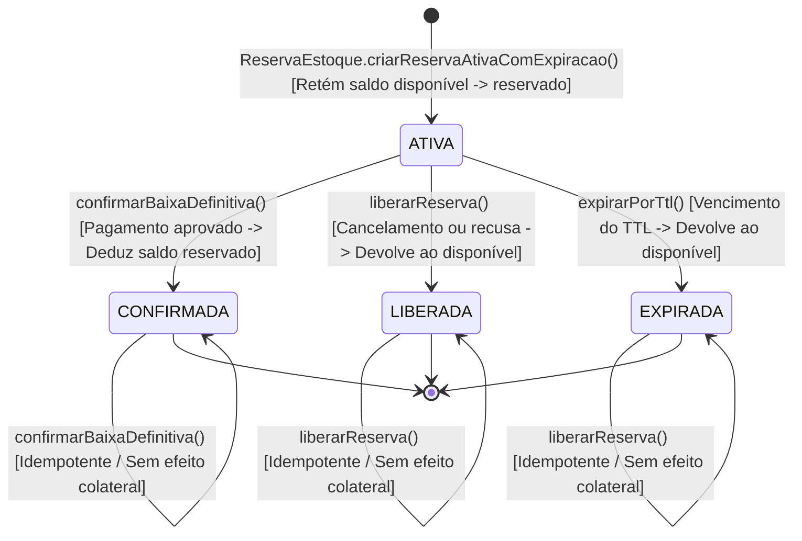
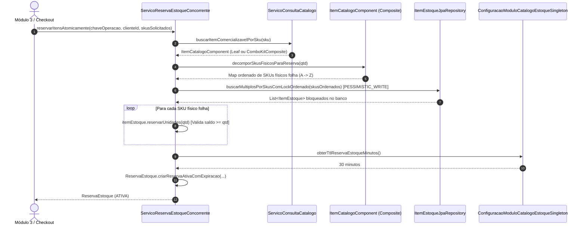
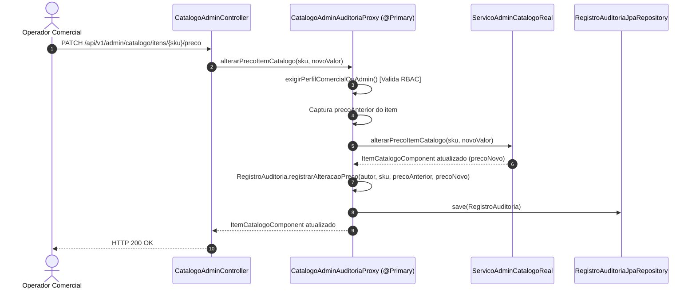

# Documentação Arquitetural e Defesa de Padrões de Projeto — Módulo 1

**Disciplina**: Engenharia de Software / Padrões de Projeto (FATEC)  
**Projeto**: Sistema de E-commerce com Promoções Avançadas  
**Módulo 1 (Integrante 1)**: Identidade, Catálogo, Composição de Produtos, Estoque e Auditoria (`001-catalogo-estoque-identidade`)  

---

## 1. Visão Geral da Arquitetura do Módulo 1

O **Módulo 1** constitui o alicerce transacional e cadastral do e-commerce, organizado em quatro subdomínios coesos e uma camada de fronteira explícita:

1. **`identidade`**: Gestão de contas `Usuario` (com senhas criptografadas via BCrypt e segregação RBAC entre `CLIENTE`, `ADMIN`, `OPERADOR_COMERCIAL`, `RESPONSAVEL_ESTOQUE` e `RESPONSAVEL_PROMOCOES`), perfil comercial `Cliente` e múltiplos endereços de entrega (`Endereco` e `EnderecoAusenteNullObject`).
2. **`catalogo`**: Árvore hierárquica recursiva de categorias (`CategoriaComp` e `CategoriaRaizNullObject`), compartilhamento em memória de atributos intrínsecos de variações (`AtributoVariacaoFlyweight`), produtos físicos, variações (`ProdutoVariacaoLeaf`) e Combos/Kits compostos recursivamente (`ComboKitComposite`).
3. **`estoque`**: Controle de saldo disponível e saldo reservado por SKU (`ItemEstoque`) com prevenção de concorrência (`PESSIMISTIC_WRITE` ordenado por SKU + `@Version`), reservas temporárias com TTL e idempotência (`ReservaEstoque`) e razão contábil de movimentações (`MovimentacaoEstoque`).
4. **`auditoria`**: Trilha imutável de auditoria administrativa (`RegistroAuditoria`) alimentada automaticamente por Proxies de proteção e auditoria (`CatalogoAdminAuditoriaProxy` e `EstoqueAdminSegurancaProxy`).
5. **`integracao`**: Portas Java desacopladas (`PortaConsultaCatalogoCliente` e `PortaComandoReservaEstoque`) consumidas pelos **Módulos 2 (Carrinho/Promoções)** e **Módulos 3 (Checkout/Pedidos/Frete)**.

---

## 2. Catálogo dos 8 Padrões de Projeto Aplicados (Defesa Acadêmica)

Para cada padrão aplicado no Módulo 1, respondemos objetivamente às três perguntas exigidas na banca:
1. **Qual problema de projeto existia?**
2. **Por que este padrão foi escolhido?**
3. **O que ficou mais simples de modificar ou estender?**

### 2.1. `Singleton` — `ConfiguracaoModuloCatalogoEstoqueSingleton`
- **Problema**: Parâmetros globais operacionais (TTL padrão de 30 min das reservas de estoque, limite de profundidade de árvore de categorias e limite de aninhamento de combos) precisavam ser consultados de forma consistente por entidades de domínio e fábricas sem acoplamento direto ao contexto Spring.
- **Escolha**: Garante instância única thread-safe em toda a JVM com ponto global de acesso `ConfiguracaoModuloCatalogoEstoqueSingleton.obterInstancia()`.
- **Extensibilidade**: Alterar o TTL de reserva de estoque em tempo de execução ou em testes reflete imediatamente em todas as novas instâncias criadas por `ReservaEstoque.criarReservaAtivaComExpiracao(...)`.

### 2.2. `Static Factory Method` — `Usuario`, `RegistroAuditoria`, `DimensoesFisicas`, `ReservaEstoque`, `MovimentacaoEstoque`
- **Problema**: Construtores públicos genéricos não expressavam a diferença semântica entre o auto-cadastro público de um `CLIENTE` e a provisão administrativa de um operador interno, nem deixavam explícitas as unidades físicas (`cm` e `gramas`) ou os diferentes tipos de eventos de auditoria e movimentação.
- **Escolha**: Construtores foram tornados privados/protegidos em favor de métodos estáticos nomeados como `Usuario.criarContaClientePublico(...)`, `Usuario.criarContaOperadorInterno(...)`, `DimensoesFisicas.emCentimetrosEGramas(...)`, `ReservaEstoque.criarReservaAtivaComExpiracao(...)` e `RegistroAuditoria.registrarAlteracaoPreco(...)`.
- **Extensibilidade**: Novos modos de criação com validações específicas podem ser adicionados sem sobrecarga ambígua de construtores.

### 2.3. `Builder` — `EnderecoBuilder`, `ClienteBuilder`, `ProdutoBuilder`, `ComboKitBuilder`
- **Problema**: Entidades ricas como `Produto` (com preço base, categoria, mapa de especificações e múltiplas variações), `ComboKitComposite`, `Cliente` e `Endereco` possuem diversos atributos e invariantes cruzadas que gerariam construtores telescópicos propensos a erro.
- **Escolha**: Permite montagem passo a passo fluente e concentra a validação completa no método finalizador `.construir()`.
- **Extensibilidade**: Novos atributos opcionais ou regras de validação na construção são incluídos no Builder sem quebrar chamadas existentes.

### 2.4. `Null Object` — `EnderecoAusenteNullObject` e `CategoriaRaizNullObject`
- **Problema**: Clientes recém-cadastrados ainda não possuem endereço selecionado para entrega, e categorias de nível raiz não possuem categoria pai, o que espalharia verificações `if (obj != null)` no cálculo de frete, elegibilidade e montagem de caminhos hierárquicos (breadcrumbs).
- **Escolha**: `Cliente.obterEnderecoSelecionado()` retorna polimorficamente `EnderecoAusenteNullObject` (`possuiEnderecoValido() == false`), e `CategoriaComp.obterCategoriaPai()` retorna `CategoriaRaizNullObject` (`eRaizNula() == true`).
- **Extensibilidade**: Consumidores como o Módulo 2 e o Módulo 3 invocam métodos diretamente na interface sem risco de `NullPointerException`.

### 2.5. `Composite` — Árvore de Categorias (`CategoriaComp`) e Combos/Kits (`ItemCatalogoComponent` / `ComboKitComposite`)
- **Problema**: O domínio possui duas estruturas hierárquicas recursivas: (a) categorias que contêm subcategorias em múltiplos níveis e (b) combos promocionais formados por produtos unitários e/ou outros sub-combos.
- **Escolha**: Permite tratar folhas e composições de maneira uniforme. Em categorias, `obterIdsSubarvoreRecursivo()` coleta todos os IDs descendentes para buscas recursivas. Em itens de catálogo, `ProdutoVariacaoLeaf` (*Leaf*) e `ComboKitComposite` (*Composite*) implementam `ItemCatalogoComponent`, calculando recursivamente preço vigente, peso total em gramas, dimensões físicas, disponibilidade pelo item gargalo ($\min(\lfloor \text{disponivel}_i / \text{qtdNoKit}_i \rfloor)$) e decomposição de SKUs físicos para reserva.
- **Extensibilidade**: O carrinho, o motor de promoções e o checkout manipulam apenas `ItemCatalogoComponent`, suportando kits aninhados de qualquer profundidade sem `instanceof` na lógica de compra.

### 2.6. `Flyweight` — `AtributoVariacaoFlyweight` + `FabricaAtributoVariacaoFlyweight`
- **Problema**: Centenas de variações de produtos repetem os mesmos atributos intrínsecos (`Cor: Preto`, `Tamanho: M`, `Voltagem: 220V`), desperdiçando memória caso cada SKU instancie cópias duplicadas.
- **Escolha**: Separa o estado intrínseco imutável (`tipo`, `valor`, `codigoApresentacao`) em `AtributoVariacaoFlyweight` e gerencia seu compartilhamento em memória via pool `ConcurrentHashMap` em `FabricaAtributoVariacaoFlyweight`, enquanto o estado extrínseco (SKU, preço adicional, estoque) permanece em `ProdutoVariacaoLeaf`.
- **Extensibilidade**: Novas variações reutilizam automaticamente as mesmas referências de memória (`assertSame`), mantendo consumo de RAM constante para atributos repetidos.

### 2.7. `Factory Method` — `CriadorItemCatalogo`, `CriadorProdutoPadrao`, `CriadorComboKitPromocional`
- **Problema**: A criação e pós-validação comercial de diferentes famílias de itens vendáveis precisava seguir um contrato padronizado (SKU obrigatório, categoria vinculada, preço vigente positivo, peso positivo) sem acoplar o serviço a uma única classe concreta.
- **Escolha**: A classe abstrata `CriadorItemCatalogo<E>` define o template `fabricarItemValidado(E)` que delega a instanciação ao Factory Method abstrato `criarItemCatalogo(E)`, implementado por `CriadorProdutoPadrao` e `CriadorComboKitPromocional`.
- **Extensibilidade**: Criar uma nova família de item comercializável exige apenas uma nova subclasse de `CriadorItemCatalogo`, respeitando o Princípio Aberto-Fechado (OCP).

### 2.8. `Proxy` (Protection & Audit Proxy) — `CatalogoAdminAuditoriaProxy` e `EstoqueAdminSegurancaProxy`
- **Problema**: Operações críticas de catálogo (alterar preço, ativar/inativar item, criar categoria/combo) e de estoque (ajuste manual de saldo) exigiam simultaneamente verificação estrita de perfil RBAC e gravação automática de estado anterior e estado novo na trilha de auditoria. Misturar essa infraestrutura dentro dos serviços reais violaria o Princípio da Responsabilidade Única (SRP).
- **Escolha**: Os Proxies implementam as mesmas interfaces (`ServicoAdminCatalogoPort` e `ServicoAdminEstoquePort`) dos sujeitos reais (`ServicoAdminCatalogoReal` e `ServicoAdminEstoqueReal`) e são injetados como `@Primary`. Interceptam cada chamada para validar o perfil do usuário, capturar o snapshot anterior, delegar ao serviço real e persistir `RegistroAuditoria`.
- **Extensibilidade**: Novas regras de auditoria ou bloqueio de segurança são ajustadas exclusivamente nos Proxies sem tocar na regra de negócio do catálogo ou estoque.

---

## 3. Diagrama de Classes UML (Domínio e Padrões do Módulo 1)

```mermaid
classDiagram
    direction TB

    class ConfiguracaoModuloCatalogoEstoqueSingleton {
        -int ttlReservaEstoqueMinutos
        +obterInstancia()$ ConfiguracaoModuloCatalogoEstoqueSingleton
        +obterTtlReservaEstoqueMinutos() int
    }

    class OpcaoEnderecoEntrega {
        <<interface>>
        +possuiEnderecoValido() boolean
        +obterCepDestino() String
        +obterUfDestino() String
        +obterResumoFormatado() String
    }

    class Endereco {
        -UUID id
        -String cep
        -String uf
        -boolean selecionadoParaEntrega
    }

    class EnderecoAusenteNullObject {
        +obterInstancia()$ EnderecoAusenteNullObject
        +possuiEnderecoValido() boolean
    }

    OpcaoEnderecoEntrega <|.. Endereco
    OpcaoEnderecoEntrega <|.. EnderecoAusenteNullObject

    class ComponenteCategoria {
        <<interface>>
        +obterId() UUID
        +obterNome() String
        +obterCaminhoHierarquico() String
        +eRaizNula() boolean
        +obterIdsSubarvoreRecursivo() Set~UUID~
    }

    class CategoriaComp {
        -UUID id
        -String nome
        -String slug
        -List~CategoriaComp~ subcategorias
        +adicionarSubcategoria(CategoriaComp) void
        +obterCategoriaPai() ComponenteCategoria
    }

    class CategoriaRaizNullObject {
        +obterInstancia()$ CategoriaRaizNullObject
        +eRaizNula() boolean
    }

    ComponenteCategoria <|.. CategoriaComp
    ComponenteCategoria <|.. CategoriaRaizNullObject
    CategoriaComp o-- CategoriaComp : subcategorias

    class ItemCatalogoComponent {
        <<interface>>
        +obterSku() String
        +calcularPrecoVigente() BigDecimal
        +obterPesoTotalGramas() int
        +obterDimensoesFisicas() DimensoesFisicas
        +calcularDisponibilidadeMaxima(Function) int
        +decomporSkusFisicosParaReserva(int) Map~String,Integer~
    }

    class ProdutoVariacaoLeaf {
        -String sku
        -BigDecimal adicionalPreco
        -DimensoesFisicas dimensoesFisicas
        -List~AtributoVariacaoFlyweight~ atributosFlyweight
    }

    class ComboKitComposite {
        -String sku
        -ModoPrecoCombo modoPreco
        -BigDecimal percentualDescontoKit
        -List~ItemComponenteKit~ componentes
        +adicionarComponente(ItemCatalogoComponent, int) void
    }

    ItemCatalogoComponent <|.. ProdutoVariacaoLeaf
    ItemCatalogoComponent <|.. ComboKitComposite
    ComboKitComposite *-- ItemComponenteKit
    ItemComponenteKit --> ItemCatalogoComponent : componenteFilho
    ProdutoVariacaoLeaf --> AtributoVariacaoFlyweight : compartilha (Flyweight)

    class ServicoAdminCatalogoPort {
        <<interface>>
        +criarCategoria(String, String, UUID) CategoriaComp
        +cadastrarProdutoComVariacoes(ProdutoBuilder, Map) Produto
        +alterarPrecoItemCatalogo(String, BigDecimal) ItemCatalogoComponent
        +alterarStatusAtivacaoItemCatalogo(String, boolean) ItemCatalogoComponent
    }

    class ServicoAdminCatalogoReal
    class CatalogoAdminAuditoriaProxy {
        -ServicoAdminCatalogoPort servicoReal
    }

    ServicoAdminCatalogoPort <|.. ServicoAdminCatalogoReal
    ServicoAdminCatalogoPort <|.. CatalogoAdminAuditoriaProxy
    CatalogoAdminAuditoriaProxy --> ServicoAdminCatalogoReal : delega e audita
```

---

## 4. Diagrama de Estados — Ciclo de Vida da Reserva de Estoque (`ReservaEstoque`)

---

## 5. Diagramas de Sequência — Concorrência no Estoque e Proxy de Auditoria

### 5.1. Reserva Atômica de Estoque com Prevenção de Concorrência e Decomposição de Combo

### 5.2. Interceptação Administrativa via `CatalogoAdminAuditoriaProxy`

---

## 6. Guia Rápido para Alteração de Requisito ao Vivo na Apresentação

Caso o professor solicite uma extensão ao vivo durante a defesa:

1. **Adicionar um novo tipo de atributo compartilhado no `Flyweight` (ex.: `ACABAMENTO` ou `GARANTIA`)**:
   - Basta adicionar a constante no enum [`TipoAtributoVariacao`](file:///c:/Coisas%20Importantes/Escola/FATEC/Trabalho%20Benio/src/main/java/br/edu/fatec/ecommerce/modulo1/catalogo/dominio/flyweight/TipoAtributoVariacao.java). O pool compartilhado em [`FabricaAtributoVariacaoFlyweight`](file:///c:/Coisas%20Importantes/Escola/FATEC/Trabalho%20Benio/src/main/java/br/edu/fatec/ecommerce/modulo1/catalogo/dominio/flyweight/FabricaAtributoVariacaoFlyweight.java) passa a suportá-lo imediatamente sem alterar uma linha de código.
2. **Adicionar uma nova família de item comercializável via `Factory Method` (ex.: `CriadorKitAssinaturaMensal`)**:
   - Basta estender [`CriadorItemCatalogo`](file:///c:/Coisas%20Importantes/Escola/FATEC/Trabalho%20Benio/src/main/java/br/edu/fatec/ecommerce/modulo1/catalogo/dominio/fabrica/CriadorItemCatalogo.java) e sobrescrever `criarItemCatalogo(...)`. Todas as pós-condições comerciais continuam garantidas pelo método template `fabricarItemValidado(...)`.
3. **Adicionar um novo evento na Trilha de Auditoria via `Static Factory Method` + `Proxy`**:
   - Basta adicionar o tipo em [`TipoOperacaoAuditoria`](file:///c:/Coisas%20Importantes/Escola/FATEC/Trabalho%20Benio/src/main/java/br/edu/fatec/ecommerce/modulo1/auditoria/dominio/TipoOperacaoAuditoria.java), criar um Static Factory Method semântico em [`RegistroAuditoria`](file:///c:/Coisas%20Importantes/Escola/FATEC/Trabalho%20Benio/src/main/java/br/edu/fatec/ecommerce/modulo1/auditoria/dominio/RegistroAuditoria.java) e invocá-lo no respectivo Proxy.

