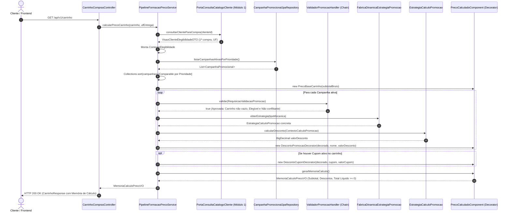

# Documentação Arquitetural e Defesa de Padrões de Projeto — Módulo 2

**Disciplina**: Engenharia de Software / Padrões de Projeto (FATEC)  
**Projeto**: Sistema de E-commerce com Promoções Avançadas  
**Módulo 2 (Integrante 2)**: Carrinho de Compras, Motor de Promoções Avançadas, Elegibilidade, Cupons e Formação de Preço (`002-carrinho-promocoes-cupons`)  
**Autor**: Eduardo Juncker Toras  

---

## 1. Visão Geral da Arquitetura do Módulo 2

O **Módulo 2** constitui o motor promocional, carrinho de compras e o pipeline financeiro de formação de preço do e-commerce, estruturado em quatro subdomínios coesos e duas camadas de fronteira:

1. **`carrinho`**: Agregado raiz `CarrinhoCompras` para sessões autenticadas e anônimas, com linhas polimórficas `ItemCarrinho` (`ItemCarrinhoProduto` e `ItemCarrinhoComboKit`) que aceitam despacho dinâmico via `ElementoCarrinhoVisitor` (`Visitor` + `Double Dispatch`) e recálculo automático de subtotais e peso total acumulado.
2. **`promocoes`**: Motor flexível de regras comerciais suportando nativamente as 4 modalidades exigidas (Leve X Pague Y, Desconto Percentual Condicional, Desconto Fixo por Meta de Carrinho e Combo Cruzado / Venda Casada) instanciadas via `FabricaDinamicaEstrategiaPromocao` (`Dynamic Factory` / `Dynamic Injection`), com árvore booleana recursiva de regras via `CondicaoElegibilidadeComponent` (`Composite` com `AND`, `OR`, `NOT` e predicados de cliente, valor, região e categoria) e pipeline de resolução de conflitos determinístico via `ValidadorPromocaoHandler` (`Chain of Responsibility`) e `Comparable<CampanhaPromocional>`.
3. **`cupons`**: Entidade `CupomPromocional` com cotas de uso, controle temporal, suporte a descontos percentuais e nominais, regras de acumulação/exclusividade e objeto neutro `CupomNulo` (`Null Object`).
4. **`precificacao`**: Pipeline de cálculo transparente estruturado em camadas decoradoras (`PrecoBaseCarrinho`, `DescontoPromocaoDecorator`, `DescontoCupomDecorator`) implementando `PrecoCalculadoComponent` (`Decorator`), gerando memória de cálculo auditável (`MemoriaCalculoPrecoVO`) e garantindo aritmética segura com `OperacoesMonetarias` (`BigDecimal`, escala 2, arredondamento `HALF_EVEN` e piso zero inegociável).
5. **`integracao`**: Consumo desacoplado do Módulo 1 através de `PortaConsultaCatalogoCliente` e disponibilização da interface Java `PortaConsultaCarrinhoPromocoes` para o **Módulo 3 (Checkout, Pedidos e Pagamentos)**.

---

## 2. Catálogo dos 8 Padrões de Projeto Aplicados (Defesa Acadêmica)

Para cada padrão aplicado no Módulo 2, respondemos com clareza às três perguntas exigidas pela banca avaliadora:
1. **Qual problema de projeto existia?**
2. **Por que este padrão foi escolhido?**
3. **O que ficou mais simples de modificar ou estender?**

### 2.1. `Composite` (Composição Recursiva) — Árvore de Condições de Elegibilidade (`CondicaoElegibilidadeComponent`)
- **Problema**: Regras comerciais combinam critérios múltiplos com precedências lógicas distintas (ex.: "Cliente em primeira compra E carrinho acima de R$ 200", ou "(Categoria Periféricos OU Categoria Games) E Região SP"). Flags no banco ou ifs encadeados limitariam a expressividade e exigiriam mudar código a cada nova campanha.
- **Escolha**: Permite tratar condições folhas (`CondicaoValorMinimoCarrinho`, `CondicaoPrimeiraCompraCliente`, `CondicaoCategoriaProduto`, `CondicaoItemEspecificoSku`, `CondicaoRegiaoEntrega`) e agrupadores lógicos (`CondicaoAndComposite`, `CondicaoOrComposite`, `CondicaoNotComposite`) sob uma mesma interface polimórfica uniforme.
- **Extensibilidade**: Criar uma nova condição atômica (ex.: `CondicaoAniversariante`) ou um novo operador (ex.: `CondicaoXorComposite`) exige apenas criar uma classe implementando `CondicaoElegibilidadeComponent` sem alterar o motor de avaliação.

### 2.2. `Chain of Responsibility` — Pipeline de Validação de Carrinho, Elegibilidade e Exclusividade (`ValidadorPromocaoHandler`)
- **Problema**: Antes de aprovar a aplicação de uma promoção, é necessário validar se o carrinho não está vazio, se a árvore de elegibilidade é satisfeita e se a promoção respeita regras de exclusividade mútua frente a promoções já aprovadas. Centralizar tudo em um método causaria acoplamento excessivo e código macarrônico.
- **Escolha**: Divide as checagens em elos desacoplados (`ValidadorCarrinhoNaoVazio`, `ValidadorElegibilidadeCampanha`, `ValidadorConflitoExclusividade`), onde cada handler pode aprovar e repassar para o próximo ou interromper o fluxo imediatamente.
- **Extensibilidade**: Adicionar uma nova validação (ex.: `ValidadorLimiteDescontoGlobal`) é feito instanciando o novo elo e conectando-o com `.definirProximo(...)` sem tocar nos demais validadores.

### 2.3. `Decorator` — Encadeamento Transparente da Formação de Preço (`PrecoCalculadoComponent`)
- **Problema**: O cliente e a contabilidade precisam enxergar a memória de cálculo com o subtotal original, cada parcela de desconto discriminada por benefício/cupom e o valor final líquido. Se uma única classe calculasse tudo, seria complexo isolar e auditar os efeitos de cada benefício financeiro.
- **Escolha**: O padrão Decorator embrulha o componente base `PrecoBaseCarrinho` com decoradores sucessivos (`DescontoPromocaoDecorator`, `DescontoCupomDecorator`). Cada camada calcula seu desconto sobre o líquido da camada anterior, registra sua rubrica em `ParcelaDescontoVO` e garante o piso zero.
- **Extensibilidade**: Adicionar uma nova camada de cálculo (ex.: `TaxaFreteDecorator` ou `CashbackDecorator`) exige apenas estender `DescontoDecoratorAbstrato` sem alterar a precificação base nem as promoções.

### 2.4. `Visitor` e `Double Dispatch` — Avaliação Polimórfica de Itens do Carrinho (`ElementoCarrinhoVisitor`)
- **Problema**: O carrinho reúne produtos simples (`ItemCarrinhoProduto`) e combos compostos (`ItemCarrinhoComboKit`). Certas promoções e relatórios precisam aplicar regras distintas sobre cada tipo sem recorrer a verificações anti-padrão como `if (item instanceof ItemCarrinhoProduto)` com casting explícito.
- **Escolha**: Cada elemento do carrinho implementa `aceitar(ElementoCarrinhoVisitor visitor)` chamando `visitor.visitarProduto(this)` ou `visitor.visitarComboKit(this)`. O compilador Java executa o duplo despacho em tempo de execução sem nenhum casting manual.
- **Extensibilidade**: Criar novas operações sobre os itens (ex.: cálculo de ICMS, gerador de extrato fiscal, acumulador de pontos) exige apenas um novo visitante (como `CalculadoraDescontoVisitor`), sem alterar as classes de itens do carrinho.

### 2.5. `Comparable` — Ordenação Determinística e Resolução de Conflitos (`CampanhaPromocional`)
- **Problema**: Quando o cliente atinge os critérios de múltiplas promoções simultâneas que não podem se acumular (exclusivas), o sistema precisa garantir uma escolha 100% determinística e transparente, sem depender da ordem aleatória do banco de dados.
- **Escolha**: A classe `CampanhaPromocional` implementa a interface nativa Java `Comparable<CampanhaPromocional>`, ordenando decrescentemente pela prioridade configurada e, em caso de empate, pelo maior benefício ou identificador alfabético.
- **Extensibilidade**: Listas de campanhas são ordenadas diretamente via `Collections.sort()` em qualquer camada do sistema com previsibilidade matemática.

### 2.6. `Dynamic Factory` e `Dynamic Injection` — Fábrica Dinâmica de Estratégias Promocionais (`FabricaDinamicaEstrategiaPromocao`)
- **Problema**: As regras de cálculo de desconto variam radicalmente: percentual, fixo, Leve X Pague Y, desconto em combo cruzado. Usar um `switch(tipoMecanica)` violaria o Princípio Aberto-Fechado (OCP) a cada nova promoção.
- **Escolha**: A fábrica mantém um catálogo indexado por `TipoMecanicaPromocao` alimentado automaticamente pela injeção de dependências do Spring (`List<EstrategiaCalculoPromocao>`), resolvendo a estratégia em tempo constante $O(1)$ sem nenhuma instrução condicional.
- **Extensibilidade**: Para adicionar uma 5ª ou 6ª mecânica (ex.: `PromocaoDescontoProgressivo`), basta criar uma nova classe com `@Component` implementando `EstrategiaCalculoPromocao`. Ela é registrada e fica disponível automaticamente no sistema.

### 2.7. `Null Object` — Representação Segura de Ausência de Benefício (`PromocaoNula` e `CupomNulo`)
- **Problema**: Carrinhos sem cupom ou sem promoções aplicáveis gerariam referências `null`, exigindo checagens defensivas `if (carrinho.getCupom() != null)` e provocando risco de `NullPointerException`.
- **Escolha**: `PromocaoNula` e `CupomNulo` implementam os mesmos contratos fornecendo comportamento neutro seguro (desconto R$ 0,00, código vazio, indisponível para uso).
- **Extensibilidade**: O pipeline de preço e os formatadores REST invocam métodos diretamente sem condicionais defensivas de nulo.

### 2.8. `Operações Matemáticas` com `BigDecimal` e Garantia de Piso Zero (`OperacoesMonetarias`)
- **Problema**: Números em ponto flutuante (`double`/`float`) acumulam erros de arredondamento inaceitáveis no comércio. Além disso, abatimentos sucessivos poderiam tornar o total líquido negativo caso os descontos superassem o subtotal bruto.
- **Escolha**: Encapsulamento de aritmética com escala 2 e arredondamento bancário `RoundingMode.HALF_EVEN`, função de piso zero `Math.max(0, base - desconto)` e algoritmo determinístico de rateio de descontos proporcionais sem perda residual de centavos.
- **Extensibilidade**: Qualquer nova estratégia de desconto utiliza os métodos auxiliares `OperacoesMonetarias`, garantindo conformidade matemática e contábil em todo o módulo.

---

## 3. Diagrama de Classes UML (Domínio e Padrões do Módulo 2)

```mermaid
classDiagram
    direction TB

    %% COMPOSITE
    class CondicaoElegibilidadeComponent {
        <<interface>>
        +avaliar(ContextoElegibilidade ctx) boolean
        +descrever() String
    }

    class CondicaoValorMinimoCarrinho {
        -BigDecimal valorMinimo
        +avaliar(ContextoElegibilidade ctx) boolean
    }

    class CondicaoPrimeiraCompraCliente {
        +avaliar(ContextoElegibilidade ctx) boolean
    }

    class CondicaoCategoriaProduto {
        -UUID categoriaId
        +avaliar(ContextoElegibilidade ctx) boolean
    }

    class CondicaoAndComposite {
        -List~CondicaoElegibilidadeComponent~ condicoesFilhas
        +adicionar(CondicaoElegibilidadeComponent c) CondicaoAndComposite
        +avaliar(ContextoElegibilidade ctx) boolean
    }

    class CondicaoOrComposite {
        -List~CondicaoElegibilidadeComponent~ condicoesFilhas
        +adicionar(CondicaoElegibilidadeComponent c) CondicaoOrComposite
        +avaliar(ContextoElegibilidade ctx) boolean
    }

    class CondicaoNotComposite {
        -CondicaoElegibilidadeComponent condicaoFilha
        +avaliar(ContextoElegibilidade ctx) boolean
    }

    CondicaoElegibilidadeComponent <|.. CondicaoValorMinimoCarrinho
    CondicaoElegibilidadeComponent <|.. CondicaoPrimeiraCompraCliente
    CondicaoElegibilidadeComponent <|.. CondicaoCategoriaProduto
    CondicaoElegibilidadeComponent <|.. CondicaoAndComposite
    CondicaoElegibilidadeComponent <|.. CondicaoOrComposite
    CondicaoElegibilidadeComponent <|.. CondicaoNotComposite
    CondicaoAndComposite o-- CondicaoElegibilidadeComponent
    CondicaoOrComposite o-- CondicaoElegibilidadeComponent
    CondicaoNotComposite o-- CondicaoElegibilidadeComponent

    %% VISITOR & DOUBLE DISPATCH
    class ElementoCarrinhoComponent {
        <<interface>>
        +aceitar(ElementoCarrinhoVisitor visitor) void
        +calcularSubtotalItem() BigDecimal
        +getQuantidade() int
    }

    class ItemCarrinho {
        <<abstract>>
        -String sku
        -BigDecimal precoUnitario
        -int quantidade
        +calcularSubtotalItem() BigDecimal
    }

    class ItemCarrinhoProduto {
        +aceitar(ElementoCarrinhoVisitor visitor) void
    }

    class ItemCarrinhoComboKit {
        +aceitar(ElementoCarrinhoVisitor visitor) void
    }

    class ElementoCarrinhoVisitor {
        <<interface>>
        +visitarProduto(ItemCarrinhoProduto produto) void
        +visitarComboKit(ItemCarrinhoComboKit combo) void
    }

    class CalculadoraDescontoVisitor {
        -BigDecimal subtotalProdutos
        -BigDecimal subtotalCombos
        +visitarProduto(ItemCarrinhoProduto produto) void
        +visitarComboKit(ItemCarrinhoComboKit combo) void
    }

    ElementoCarrinhoComponent <|.. ItemCarrinho
    ItemCarrinho <|-- ItemCarrinhoProduto
    ItemCarrinho <|-- ItemCarrinhoComboKit
    ElementoCarrinhoVisitor <|.. CalculadoraDescontoVisitor
    ItemCarrinhoProduto ..> ElementoCarrinhoVisitor : "aceitar(v) -> v.visitarProduto(this)"
    ItemCarrinhoComboKit ..> ElementoCarrinhoVisitor : "aceitar(v) -> v.visitarComboKit(this)"

    %% DECORATOR
    class PrecoCalculadoComponent {
        <<interface>>
        +obterSubtotalBruto() BigDecimal
        +obterTotalLiquido() BigDecimal
        +obterDiscriminativoDescontos() List~ParcelaDescontoVO~
        +gerarMemoriaCalculo() MemoriaCalculoPrecoVO
    }

    class PrecoBaseCarrinho {
        -BigDecimal subtotalBruto
        +obterTotalLiquido() BigDecimal
    }

    class DescontoDecoratorAbstrato {
        <<abstract>>
        #PrecoCalculadoComponent decorado
        +obterSubtotalBruto() BigDecimal
    }

    class DescontoPromocaoDecorator {
        -String nomePromocao
        -BigDecimal valorDesconto
        +obterTotalLiquido() BigDecimal
    }

    class DescontoCupomDecorator {
        -String codigoCupom
        -BigDecimal valorDesconto
        +obterTotalLiquido() BigDecimal
    }

    PrecoCalculadoComponent <|.. PrecoBaseCarrinho
    PrecoCalculadoComponent <|.. DescontoDecoratorAbstrato
    DescontoDecoratorAbstrato o-- PrecoCalculadoComponent
    DescontoDecoratorAbstrato <|-- DescontoPromocaoDecorator
    DescontoDecoratorAbstrato <|-- DescontoCupomDecorator
```

---

## 4. Diagrama de Sequência — Avaliação e Formação de Preço do Carrinho

---

## 5. Guia Rápido para Alteração de Requisito ao Vivo na Apresentação

Caso a banca de professores solicite uma modificação ou extensão ao vivo durante a apresentação:

1. **Adicionar uma nova modalidade de promoção (ex.: `DescontoProgressivoPorQtd`)**:
   - Basta adicionar o valor no enum [`TipoMecanicaPromocao`](file:///c:/Users/Edu/ecommerce-promocoes-avancadas/src/main/java/br/edu/fatec/ecommerce/modulo2/promocoes/dominio/TipoMecanicaPromocao.java) e criar uma nova classe anotada com `@Component` implementando [`EstrategiaCalculoPromocao`](file:///c:/Users/Edu/ecommerce-promocoes-avancadas/src/main/java/br/edu/fatec/ecommerce/modulo2/promocoes/dominio/fabrica/EstrategiaCalculoPromocao.java). A [`FabricaDinamicaEstrategiaPromocao`](file:///c:/Users/Edu/ecommerce-promocoes-avancadas/src/main/java/br/edu/fatec/ecommerce/modulo2/promocoes/dominio/fabrica/FabricaDinamicaEstrategiaPromocao.java) a descobrirá e injetará automaticamente sem alterar uma única linha dos controllers ou serviços existentes.
2. **Adicionar uma nova condição de elegibilidade no `Composite` (ex.: `CondicaoFaixaHoraria` ou `CondicaoCupomParceiro`)**:
   - Basta criar uma nova classe implementando [`CondicaoElegibilidadeComponent`](file:///c:/Users/Edu/ecommerce-promocoes-avancadas/src/main/java/br/edu/fatec/ecommerce/modulo2/promocoes/dominio/composite/CondicaoElegibilidadeComponent.java) e sobrescrever `avaliar(ContextoElegibilidade)`. Ela pode ser imediatamente combinada dentro de qualquer `CondicaoAndComposite`, `CondicaoOrComposite` ou `CondicaoNotComposite`.
3. **Adicionar uma nova camada no cálculo de preço (ex.: `TaxaEmbalagemPresenteDecorator`)**:
   - Basta estender [`DescontoDecoratorAbstrato`](file:///c:/Users/Edu/ecommerce-promocoes-avancadas/src/main/java/br/edu/fatec/ecommerce/modulo2/precificacao/dominio/DescontoDecoratorAbstrato.java) e sobrescrever `obterTotalLiquido()` e `obterDiscriminativoDescontos()`. O pipeline e a memória de cálculo a incorporarão de forma transparente.

