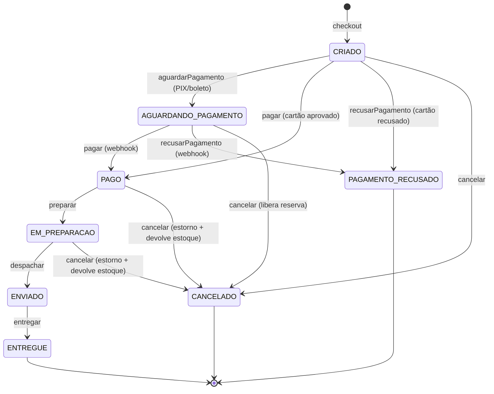
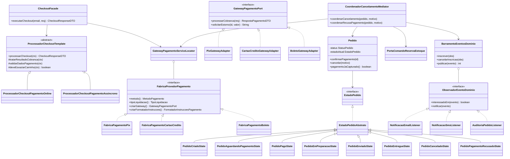
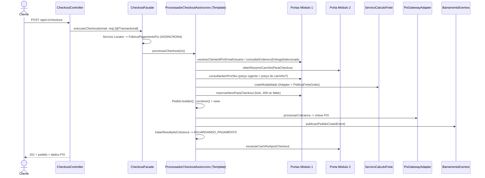
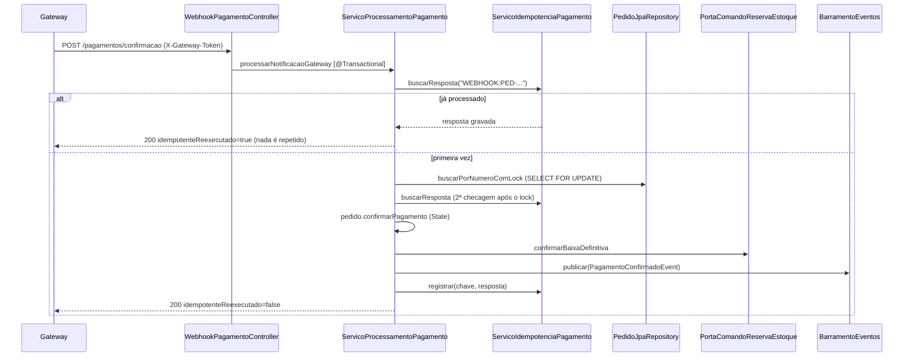

# Documentação Arquitetural e Defesa de Padrões de Projeto — Módulo 3

**Disciplina**: Engenharia de Software / Padrões de Projeto (FATEC)
**Projeto**: Sistema de E-commerce com Promoções Avançadas
**Módulo 3 (Integrante 3)**: Checkout, Ciclo de Vida de Pedidos, Pagamentos Idempotentes, Frete, Eventos/Notificações e Relatórios Gerenciais (`003-checkout-pedidos-pagamentos`)
**Autor**: Henrique Sandrini

---

## 1. Visão geral

O Módulo 3 transforma o carrinho (Módulo 2) em um **pedido com snapshot comercial imutável**, cobra o cliente, controla o ciclo de vida do pedido e fecha o ciclo com notificações e relatórios. Ele fala com os outros módulos **somente por portas Java** (nunca importa entidades JPA de outro módulo no código de negócio).

| Subdomínio (pacote) | Responsabilidade | Classes principais |
|---|---|---|
| `checkout` | Fechamento de compra | `CheckoutFacade`, `ProcessadorCheckoutTemplate` (+ `...PagamentoOnline`, `...PagamentoAssincrono`), `CalculadoraRateioDesconto`, `GeradorNumeroPedido` |
| `pedido` | Agregado, ciclo de vida, consulta, cancelamento, expedição | `Pedido` (+ `Pedido.Builder`), `EstadoPedido` + 8 estados, `ServicoCancelamentoPedido` (+ `CancelamentoPeloCliente`, `CancelamentoPeloAdministrador`), `ServicoOperacoesPedido`, `ServicoConsultaPedido` |
| `pagamento` | Cobrança, webhook idempotente | `GatewayPagamentoPort` + 3 adapters, `FabricaProvedorPagamento` + 3 fábricas, `GatewayPagamentoServiceLocator`, `ServicoProcessamentoPagamento`, `ServicoIdempotenciaPagamento` |
| `frete` | Cotação e frete grátis | `CalculadoraFretePort`, `AdaptadorCorreiosBase` (PAC/SEDEX), `TransportadoraExpressaAdapter`, `ApiCorreiosSimulada`, `ApiTransportadoraExpressaSimulada`, `PoliticaFreteGratis`, `RegiaoEntrega`, `ServicoCalculoFrete` |
| `mediador` | Compensações pós-venda | `CoordenadorCancelamentoMediator` |
| `eventos` / `notificacao` | Observer | `BarramentoEventosDominio`, `ObservadorEventoDominio`, 5 eventos (`record`), `NotificacaoEmailListener`, `NotificacaoSmsListener`, `AuditoriaPedidoListener` |
| `relatorios` | Relatórios gerenciais | `ServicoRelatoriosGerenciais`, `RelatoriosAdminController` |

---

## 2. Padrões de projeto (as 3 perguntas da banca)

### 2.1 Facade — `CheckoutFacade`
- **Problema**: fechar uma compra envolve cliente/endereço (M1), carrinho/promoções (M2), estoque (M1), frete, pagamento, pedido e eventos. Se o controller chamasse tudo, cada mudança no checkout mexeria na camada HTTP.
- **Por que**: um único método `executarCheckout(email, requisicao)` esconde os 7 subsistemas, abre a transação (tudo ou nada) e escolhe a especialização certa do Template Method.
- **O que ficou fácil**: incluir uma etapa (ex.: antifraude) sem tocar no controller nem nos outros módulos.

### 2.2 Template Method + Hook Method — checkout e cancelamento
- **Problema**: a ordem do checkout é inegociável (reservar estoque antes de cobrar, notificar depois), mas cartão e PIX/boleto reagem diferente à resposta do gateway. No cancelamento, a ordem também é fixa, mas cliente e administrador têm regras de autorização diferentes.
- **Por que**: `ProcessadorCheckoutTemplate.processarCheckout()` e `ServicoCancelamentoPedido.cancelar()` são `final`. O que varia está em pontos explícitos:
  - checkout: `tratarResultadoCobranca` (abstrato), `validarDadosPagamento` e `deveEsvaziarCarrinho` (hooks);
  - cancelamento: `validarAutorizacao` e `origemSolicitacao` (abstratos), `montarMotivo` (hook).
- **O que ficou fácil**: um novo meio de pagamento reaproveita estoque, frete, snapshot e eventos; ninguém consegue "esquecer" uma etapa.

### 2.3 State — `EstadoPedido` e 8 estados concretos
- **Problema**: 8 estados e 7 operações = 56 combinações. Com `if/switch` espalhados, uma combinação esquecida permitiria, por exemplo, pagar um pedido cancelado.
- **Por que**: cada estado é uma classe; `EstadoPedidoAbstrato` **nega tudo por padrão** e cada estado sobrescreve apenas o que permite. `pagamentoJaCapturado()` é uma consulta polimórfica usada pelo Mediator no lugar de um `switch`.
- **O que ficou fácil**: novo estado (ex.: `DEVOLUCAO_SOLICITADA`) = nova classe + ajuste dos vizinhos.

### 2.4 Adapter / Anti-Corruption Layer — pagamentos e frete
- **Problema**: cada provedor tem contrato próprio (Correios: códigos de serviço, peso em kg como texto, valores `"28,50"`; transportadora: centavos e horas).
- **Por que**: `GatewayPagamentoPort` e `CalculadoraFretePort` são os contratos internos; os adapters traduzem para/de `ApiCorreiosSimulada` e `ApiTransportadoraExpressaSimulada` (os *Adaptees*). `AdaptadorCorreiosBase` aplica Template Method à tradução comum de PAC e SEDEX.
- **O que ficou fácil**: nova transportadora = constante em `ModalidadeFrete` + 1 adapter.

### 2.5 Abstract Factory + Service Locator — famílias de pagamento
- **Problema**: cada meio de pagamento exige peças que precisam combinar: gateway, texto de instruções ao cliente e forma de liquidação (online × assíncrona).
- **Por que**: `FabricaProvedorPagamento` cria a família inteira (`criarGateway`, `criarFormatadorInstrucoes`, `tipoLiquidacao`). O `GatewayPagamentoServiceLocator` monta um `EnumMap<MetodoPagamento, Fabrica>` com as fábricas injetadas pelo Spring.
- **O que ficou fácil**: novo meio (ex.: carteira digital) = enum + adapter + fábrica `@Component`.

### 2.6 Observer — `BarramentoEventosDominio`
- **Problema**: pagamento/cancelamento/envio precisam disparar e-mail, SMS e auditoria; chamar cada canal diretamente acoplaria o fluxo de negócio a infraestrutura.
- **Por que**: o barramento (Subject) mantém os observadores (attach/detach), notifica só os interessados (`interessadoEm`) e isola falhas (um canal com erro não derruba os outros nem a transação).
- **O que ficou fácil**: novo canal (WhatsApp, ERP) = nova classe `@Component` implementando `ObservadorEventoDominio`.

### 2.7 Mediator — `CoordenadorCancelamentoMediator`
- **Problema**: no cancelamento e na recusa, pedido, gateway (estorno), transação financeira, estoque (M1) e notificações precisam agir em ordem; sem um coordenador, eles se referenciariam mutuamente.
- **Por que**: os participantes só conhecem o mediador, que decide: validar no State → estornar ou cancelar a cobrança → devolver ou liberar o estoque → publicar o evento.
- **O que ficou fácil**: a política de compensação está em uma única classe, testável isoladamente.

### 2.8 Apoio: Builder, Static Factory Method e Value Objects
- `Pedido.Builder` valida o snapshot completo antes de existir um pedido (cliente, entrega, pagamento, valores e ao menos um item).
- Eventos, `CotacaoFrete`, `RespostaPagamentoDTO` usam Static Factory Methods semânticos (`de(...)`, `pixEmitido(...)`, `comFreteGratis()`).
- `SnapshotFinanceiro`, `EnderecoEntregaSnapshot` e `CotacaoFrete` são Value Objects imutáveis com `BigDecimal` (escala 2, `HALF_EVEN`, piso zero).

---

## 3. Diagramas UML

### 3.1 Diagrama de estados do pedido

Qualquer seta que não aparece no diagrama lança `TransicaoEstadoInvalidaException` (HTTP 400). Exemplo: `ENVIADO --cancelar-->` é bloqueado com orientação de devolução.

### 3.2 Diagrama de classes (núcleo)

### 3.3 Sequência — checkout (PIX)

### 3.4 Sequência — confirmação de pagamento idempotente

---

## 4. Integração com os Módulos 1 e 2

| Porta | Método | Uso no Módulo 3 |
|---|---|---|
| `PortaConsultaCatalogoCliente` (M1) | `resolverClienteIdPorEmailUsuario` *(nova)* | descobrir o cliente logado |
| | `consultarClienteParaCompra` | nome e CPF para a cobrança |
| | `consultarEnderecoEntregaSelecionado` *(nova)* | endereço completo do snapshot (Null Object → `Optional.empty()`) |
| | `consultarItemPorSku` | detectar preço alterado desde a adição ao carrinho (409) |
| `PortaComandoReservaEstoque` (M1) | `reservarItensParaCheckout` | reserva atômica no checkout |
| | `confirmarBaixaDefinitiva` | pagamento aprovado |
| | `liberarReservaPorCancelamentoOuRecusa` | cancelamento antes do pagamento / recusa |
| | `estornarBaixaDefinitivaPorCancelamento` *(nova)* | cancelamento de pedido já pago (estado `ESTORNADA_POS_BAIXA`) |
| `PortaRegistroAuditoria` (M1, *nova*) | `registrarCancelamentoPedido` | trilha de auditoria do cancelamento |
| `PortaConsultaCarrinhoPromocoes` (M2) | `resolverIdentificadorCarrinhoPorEmail` *(nova)* | dono do carrinho = `Cliente.id` real |
| | `obterResumoCarrinhoParaCheckout` (+ campo `itens`) | itens, preços, descontos, cupom e promoções |
| | `esvaziarCarrinhoAposCheckout` | após checkout aprovado/pendente |
| | `confirmarConsumoDeCupom` | só quando o pagamento é confirmado |

---

## 5. Endpoints REST

| Método | Rota | Perfil | Observação |
|---|---|---|---|
| POST | `/api/v1/checkout` | CLIENTE | 201; 400 sem endereço/carrinho vazio; 409 sem estoque ou preço alterado |
| GET | `/api/v1/pedidos/me` | CLIENTE | histórico |
| GET | `/api/v1/pedidos/{id}` | CLIENTE (próprio) / ADMIN | 403 para pedido de outro cliente |
| DELETE | `/api/v1/pedidos/{id}/cancelamento?motivo=` | CLIENTE (próprio) / ADMIN | 400 se enviado/entregue |
| PATCH | `/api/v1/admin/pedidos/{id}/preparar` \| `/despachar` \| `/entregar` | ADMIN / OPERADOR_COMERCIAL | transições de expedição |
| POST | `/api/v1/pagamentos/confirmacao` | público + `X-Gateway-Token` | idempotente |
| POST | `/api/v1/frete/calcular` | público | 3 modalidades + frete grátis |
| GET | `/api/v1/admin/relatorios/vendas-consolidadas` \| `/ticket-medio` \| `/produtos-mais-vendidos` \| `/cancelamentos` | ADMIN | |

---

## 6. Testes automatizados (Princípio VI)

| Classe | O que prova |
|---|---|
| `MaquinaEstadosPedidoTest` | ciclo feliz, transições ilegais, Builder |
| `CalculoFreteEPoliticaFreteGratisTest` | valores/prazos por região, frete grátis só no PAC, rateio de desconto |
| `BarramentoEventosObserverTest` | attach/detach, interesse seletivo, isolamento de falhas |
| `CheckoutFacadeIntegrationTest` | snapshot, reserva, carrinho esvaziado, sem endereço, última unidade (409), checkout idempotente, cartão aprovado/recusado |
| `PagamentoIdempotenciaIntegrationTest` | webhook duplicado sem dupla baixa nem evento duplicado, token, valor divergente, recusa |
| `CancelamentoPedidoMediatorTest` | cancelamento antes/depois do pagamento, enviado bloqueado, 403, auditoria, webhook após cancelamento |
| `RelatoriosGerenciaisAdminTest` | consistência aritmética e RBAC |
| `InicializadorDemonstracaoModulo3Test` | carga de demonstração pelos fluxos reais |
