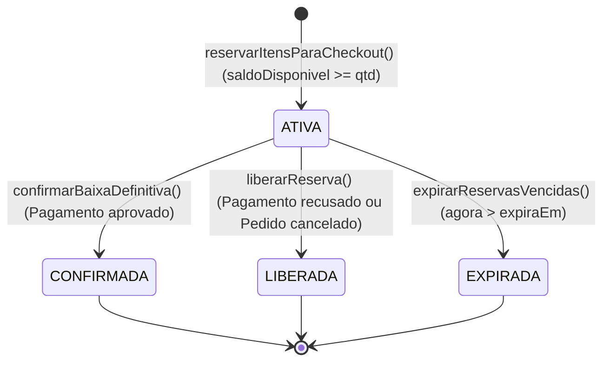

# Data Model: Módulo 1 — Identidade, Catálogo, Composição de Produtos, Estoque e Auditoria

**Feature**: `001-catalogo-estoque-identidade`  
**Date**: 2026-10-26

---

## 1. Visão Geral do Modelo de Domínio e Padrões Aplicados

```mermaid
classDiagram
    class Usuario {
        +UUID id
        +String email
        +String senhaHash
        +boolean ativo
        +Set~PerfilUsuario~ perfis
        +criarContaClientePublico()$ Usuario
        +criarContaOperadorInterno()$ Usuario
    }

    class Cliente {
        +UUID id
        +UUID usuarioId
        +String nomeCompleto
        +String cpf
        +String telefone
        +boolean primeiraCompraConcluida
        +List~Endereco~ enderecos
        +OpcaoEnderecoEntrega obterEnderecoSelecionado()
    }

    class OpcaoEnderecoEntrega {
        <<interface>>
        +boolean possuiEnderecoValido()
        +String obterCep()
        +String obterUfRegiao()
        +String obterResumoFormatado()
    }

    class Endereco {
        +UUID id
        +String apelido
        +String cep
        +String logradouro
        +String numero
        +String complemento
        +String bairro
        +String cidade
        +String uf
        +boolean selecionadoParaEntrega
    }

    class EnderecoAusenteNullObject {
        +boolean possuiEnderecoValido() false
        +String obterResumoFormatado()
    }

    class ComponenteCategoria {
        <<interface>>
        +UUID obterId()
        +String obterNome()
        +String obterSlug()
        +String obterCaminhoCompleto()
        +Set~UUID~ obterIdsSubarvoreRecursivo()
    }

    class CategoriaComp {
        +UUID id
        +String nome
        +String slug
        +ComponenteCategoria categoriaPai
        +List~ComponenteCategoria~ subcategorias
        +adicionarSubcategoria(ComponenteCategoria)
    }

    class CategoriaRaizNullObject {
        +String obterCaminhoCompleto() ""
    }

    class ItemCatalogoComponent {
        <<interface>>
        +String obterCodigoSku()
        +String obterNomeComercial()
        +BigDecimal calcularPrecoVigente()
        +DimensoesFisicas calcularDimensoesEPeso()
        +int calcularDisponibilidadeMaximaEstoque()
        +Map~String, Integer~ decomporSkusFisicosParaReserva(int quantidade)
    }

    class ProdutoVariacaoLeaf {
        +UUID id
        +String sku
        +String nome
        +BigDecimal precoBase
        +BigDecimal adicionalVariacao
        +DimensoesFisicas dimensoes
        +List~AtributoVariacaoFlyweight~ atributosIntrinsecos
    }

    class ComboKitComposite {
        +UUID id
        +String skuCombo
        +String nomeCombo
        +ModoPrecoCombo modoPreco
        +BigDecimal precoFixoOpcional
        +BigDecimal percentualDescontoKit
        +List~ItemComponenteKit~ componentes
    }

    class AtributoVariacaoFlyweight {
        +TipoAtributoVariacao tipo
        +String chaveNormalizada
        +String valorExibicao
        +String metadadoExtra
    }

    class ItemEstoque {
        +String sku
        +int quantidadeDisponivel
        +int quantidadeReservada
        +long versaoLock
    }

    class ReservaEstoque {
        +UUID id
        +String chaveOperacaoPedido
        +EstadoReservaEstoque estado
        +Instant criadaEm
        +Instant expiraEm
        +List~ItemReservaEstoque~ itensReservados
    }

    class RegistroAuditoria {
        +UUID id
        +UUID usuarioResponsavelId
        +String emailResponsavel
        +PerfilUsuario perfilResponsavel
        +TipoOperacaoAuditoria tipoOperacao
        +String tipoEntidadeAlvo
        +String identificadorAlvo
        +String valorAnteriorResumo
        +String valorNovoResumo
        +Instant ocorridoEm
    }

    Cliente "1" --> "1" Usuario
    Cliente "1" --> "*" Endereco
    OpcaoEnderecoEntrega <|.. Endereco
    OpcaoEnderecoEntrega <|.. EnderecoAusenteNullObject
    ComponenteCategoria <|.. CategoriaComp
    ComponenteCategoria <|.. CategoriaRaizNullObject
    CategoriaComp "1" o-- "*" ComponenteCategoria : subcategorias (Composite)
    ItemCatalogoComponent <|.. ProdutoVariacaoLeaf
    ItemCatalogoComponent <|.. ComboKitComposite
    ComboKitComposite "1" o-- "2..*" ItemCatalogoComponent : componentes (Composite)
    ProdutoVariacaoLeaf "*" --> "*" AtributoVariacaoFlyweight : compartilha (Flyweight)
    ProdutoVariacaoLeaf "1" --> "1" ItemEstoque
    ReservaEstoque "1" *-- "1..*" ItemEstoque : reserva SKUs
```

---

## 2. Entidades, Campos e Regras de Validação

### 2.1. `Usuario` e `PerfilUsuario` (Identidade e Acesso)
- **Tabela**: `usuarios` e `usuario_perfis`
- **Campos**:
  - `id` (`UUID`, PK, obrigatório)
  - `email` (`VARCHAR(180)`, único, obrigatório, formato de e-mail válido, normalizado em minúsculas)
  - `senhaHash` (`VARCHAR(255)`, obrigatório, hash `BCrypt` irreversível — nunca texto puro)
  - `ativo` (`BOOLEAN`, obrigatório, padrão `true`)
  - `perfis` (`Set<PerfilUsuario>`: `CLIENTE`, `ADMIN`, `OPERADOR_COMERCIAL`, `RESPONSAVEL_ESTOQUE`, `RESPONSAVEL_PROMOCOES`)
  - `criadoEm` (`TIMESTAMP WITH TIME ZONE`, obrigatório)
- **Regras de Validação (`FR-001`, `FR-002`)**:
  - Auto-cadastro público cria exclusivamente usuários com `PerfilUsuario.CLIENTE` via `Usuario.criarContaClientePublico(...)` (`Static Factory Method`).
  - Criação ou promoção de perfis administrativos/operacionais só é permitida por um usuário `ADMIN` autenticado via `Usuario.criarContaOperadorInterno(...)`.

### 2.2. `Cliente` e `Endereco` / `EnderecoAusenteNullObject`
- **Tabelas**: `clientes` e `enderecos_cliente`
- **Campos de `Cliente`**:
  - `id` (`UUID`, PK)
  - `usuarioId` (`UUID`, FK única para `usuarios.id`, obrigatório)
  - `nomeCompleto` (`VARCHAR(150)`, obrigatório, mín. 3 caracteres)
  - `cpf` (`VARCHAR(11)`, único, obrigatório, apenas dígitos com validação de dígitos verificadores)
  - `telefone` (`VARCHAR(20)`, obrigatório)
  - `primeiraCompraConcluida` (`BOOLEAN`, padrão `false` — utilizado pelo Módulo 2 para elegibilidade de "primeira compra")
- **Campos de `Endereco`**:
  - `id` (`UUID`, PK)
  - `clienteId` (`UUID`, FK para `clientes.id`, obrigatório)
  - `apelido` (`VARCHAR(60)`, obrigatório, ex.: `"Casa"`, `"Trabalho"`)
  - `cep` (`VARCHAR(8)`, obrigatório, 8 dígitos numéricos)
  - `logradouro` (`VARCHAR(180)`, obrigatório)
  - `numero` (`VARCHAR(30)`, obrigatório)
  - `complemento` (`VARCHAR(100)`, opcional)
  - `bairro` (`VARCHAR(100)`, obrigatório)
  - `cidade` (`VARCHAR(100)`, obrigatório)
  - `uf` (`CHAR(2)`, obrigatório — sigla de UF brasileira válida, usada para regras regionais de frete/promoção)
  - `selecionadoParaEntrega` (`BOOLEAN`, obrigatório — no máximo 1 endereço marcado como `true` por cliente)
- **Padrão `Null Object` (`FR-004`)**:
  - Quando `cliente.obterEnderecoSelecionado()` é chamado e nenhum endereço está cadastrado ou marcado, retorna a instância `EnderecoAusenteNullObject.obterInstancia()`, cujo método `possuiEnderecoValido()` retorna `false` sem lançar `NullPointerException`.

### 2.3. `CategoriaComp` e `CategoriaRaizNullObject` (Padrão `Composite` + `Null Object`)
- **Tabela**: `categorias`
- **Campos**:
  - `id` (`UUID`, PK)
  - `nome` (`VARCHAR(100)`, obrigatório)
  - `slug` (`VARCHAR(120)`, único, obrigatório)
  - `descricao` (`VARCHAR(300)`, opcional)
  - `categoriaPaiId` (`UUID`, FK opcional auto-referenciada para `categorias.id`; quando ausente em banco, o domínio associa `CategoriaRaizNullObject`)
  - `ativa` (`BOOLEAN`, padrão `true`)
- **Regras de Validação (`FR-007`)**:
  - Proibição de ciclos hierárquicos: ao definir ou alterar `categoriaPai`, o método recursivo `contemSubcategoriaNaArvore(id)` verifica se a nova categoria pai já é descendente da categoria atual; caso positivo, rejeita a operação.
  - Profundidade máxima validada via `ConfiguracaoModuloCatalogoEstoqueSingleton` (padrão: 10 níveis).

### 2.4. `Produto`, `ProdutoVariacaoLeaf` e `AtributoVariacaoFlyweight` (`Builder`, `Factory Method`, `Flyweight`)
- **Tabelas**: `produtos`, `variacoes_produto`, `atributos_variacao_flyweight`, `variacao_atributos_link`
- **Campos de `Produto`**:
  - `id` (`UUID`, PK)
  - `nome` (`VARCHAR(160)`, obrigatório)
  - `descricao` (`TEXT`, obrigatório)
  - `marca` (`VARCHAR(100)`, obrigatório)
  - `precoBase` (`NUMERIC(15,2)`, obrigatório, estritamente `> 0.00`)
  - `categoriaId` (`UUID`, FK para `categorias.id`, obrigatório)
  - `pesoGramas` (`INTEGER`, obrigatório, `> 0`)
  - `alturaCm`, `larguraCm`, `profundidadeCm` (`NUMERIC(8,2)`, obrigatórios, `> 0`)
  - `urlsImagens` (`List<String>`, opcional)
  - `atributosEspecificos` (`Map<String, String>`, extensível por tipo de produto: ISBN, voltagem, validade, etc.)
  - `ativo` (`BOOLEAN`, padrão `true`)
- **Campos de `ProdutoVariacaoLeaf` (implementa `ItemCatalogoComponent`)**:
  - `id` (`UUID`, PK)
  - `produtoId` (`UUID`, FK para `produtos.id`, obrigatório)
  - `sku` (`VARCHAR(64)`, único em todo o catálogo, obrigatório)
  - `nomeVariacao` (`VARCHAR(180)`, obrigatório)
  - `adicionalPreco` (`NUMERIC(15,2)`, padrão `0.00`, onde `precoBase + adicionalPreco > 0.00`)
  - `atributosIntrinsecos` (`List<AtributoVariacaoFlyweight>` — instâncias imutáveis obtidas de `FabricaAtributoVariacaoFlyweight`)
  - `ativo` (`BOOLEAN`, padrão `true`)

### 2.5. `ComboKitComposite` e `ItemComponenteKit` (Padrão `Composite`)
- **Tabelas**: `combos_kits` e `combo_kit_itens`
- **Campos de `ComboKitComposite` (implementa `ItemCatalogoComponent`)**:
  - `id` (`UUID`, PK)
  - `skuCombo` (`VARCHAR(64)`, único em todo o catálogo, obrigatório)
  - `nomeCombo` (`VARCHAR(160)`, obrigatório)
  - `descricao` (`TEXT`, obrigatório)
  - `categoriaId` (`UUID`, FK para `categorias.id`, obrigatório)
  - `modoPreco` (`ENUM`: `PRECO_FIXO_DEDICADO`, `SOMA_RECURSIVA_COMPONENTES`)
  - `precoFixoOpcional` (`NUMERIC(15,2)`, obrigatório quando `modoPreco == PRECO_FIXO_DEDICADO`, `> 0.00`)
  - `percentualDescontoKit` (`NUMERIC(5,2)`, padrão `0.00`, entre `0.00` e `90.00`, aplicado quando `modoPreco == SOMA_RECURSIVA_COMPONENTES`)
  - `componentes` (`List<ItemComponenteKit>`, mínimo de 2 itens ou soma de quantidades $\ge 2$)
  - `ativo` (`BOOLEAN`, padrão `true`)
- **Campos de `ItemComponenteKit`**:
  - `componenteSku` (`VARCHAR(64)`, referência a um `ItemCatalogoComponent` filho — variação simples ou sub-combo)
  - `quantidadePorKit` (`INTEGER`, obrigatório, $\ge 1$)
- **Regras de Validação (`FR-008`)**:
  - Detecção recursiva de ciclo: um `ComboKitComposite` nunca pode conter a si mesmo direta ou indiretamente.
  - Decomposição recursiva de estoque: `decomporSkusFisicosParaReserva(int qtdKits)` percorre toda a árvore do kit e consolida o mapa total de SKUs físicos (`ProdutoVariacaoLeaf`) e quantidades necessárias.

### 2.6. `ItemEstoque`, `ReservaEstoque` e `MovimentacaoEstoque`
- **Tabelas**: `itens_estoque`, `reservas_estoque`, `itens_reserva_estoque`, `movimentacoes_estoque`
- **Campos de `ItemEstoque`**:
  - `sku` (`VARCHAR(64)`, PK)
  - `quantidadeDisponivel` (`INTEGER`, obrigatório, $\ge 0$)
  - `quantidadeReservada` (`INTEGER`, obrigatório, $\ge 0$)
  - `versaoLock` (`BIGINT`, `@Version` para controle de concorrência otimista combinado ao lock pessimista nas reservas)
  - `atualizadoEm` (`TIMESTAMP WITH TIME ZONE`)
- **Campos de `ReservaEstoque`**:
  - `id` (`UUID`, PK)
  - `chaveOperacaoPedido` (`VARCHAR(100)`, única, obrigatória — garante idempotência por tentativa de checkout/pedido)
  - `clienteId` (`UUID`, obrigatório)
  - `estado` (`ENUM`: `ATIVA`, `CONFIRMADA`, `LIBERADA`, `EXPIRADA`)
  - `criadaEm` (`TIMESTAMP WITH TIME ZONE`, obrigatório)
  - `expiraEm` (`TIMESTAMP WITH TIME ZONE`, obrigatório — calculado com base no TTL configurável, padrão 30 minutos)
  - `finalizadaEm` (`TIMESTAMP WITH TIME ZONE`, opcional)
  - `itensReservados` (`List<ItemReservaEstoque>`: `sku`, `quantidadeReservada`)

### 2.7. `RegistroAuditoria` (Trilha Imutável — Padrão `Proxy`)
- **Tabela**: `registros_auditoria`
- **Campos**:
  - `id` (`UUID`, PK)
  - `usuarioResponsavelId` (`UUID`, obrigatório)
  - `emailResponsavel` (`VARCHAR(180)`, obrigatório)
  - `perfilResponsavel` (`VARCHAR(40)`, obrigatório)
  - `tipoOperacao` (`ENUM`: `ALTERACAO_PRECO_PRODUTO`, `ALTERACAO_PRECO_COMBO`, `CRIACAO_ALTERACAO_CATEGORIA`, `AJUSTE_MANUAL_ESTOQUE`, `ATIVACAO_INATIVACAO_ITEM`, `ALTERACAO_CAMPANHA`, `CANCELAMENTO_PEDIDO_ADMIN`)
  - `tipoEntidadeAlvo` (`VARCHAR(80)`, obrigatório)
  - `identificadorAlvo` (`VARCHAR(100)`, obrigatório)
  - `valorAnteriorResumo` (`TEXT`, obrigatório)
  - `valorNovoResumo` (`TEXT`, obrigatório)
  - `ocorridoEm` (`TIMESTAMP WITH TIME ZONE`, obrigatório, imutável)

---

## 3. Transições de Estado de `ReservaEstoque`

- **Regras de Transição e Idempotência (`FR-010`, `FR-011`)**:
  - `ATIVA -> CONFIRMADA`: deduz `quantidadeReservada` em `ItemEstoque` (as unidades já haviam saído de `quantidadeDisponivel` no ato da reserva) e grava `MovimentacaoEstoque(BAIXA_DEFINITIVA)`. Se a reserva já estiver `CONFIRMADA`, a chamada retorna sucesso sem repetir a baixa (idempotência).
  - `ATIVA -> LIBERADA` ou `ATIVA -> EXPIRADA`: deduz `quantidadeReservada` e soma de volta em `quantidadeDisponivel` para todos os SKUs da reserva, gravando `MovimentacaoEstoque(LIBERACAO_RESERVA)`. Se a reserva já estiver `LIBERADA` ou `EXPIRADA`, retorna sucesso sem duplicar a devolução de saldo (idempotência).
  - Transições inválidas (ex.: tentar liberar uma reserva já `CONFIRMADA` sem ser fluxo de devolução, ou confirmar uma reserva já `LIBERADA`/`EXPIRADA`) lançam exceção de domínio explícita (`TransicaoEstadoReservaInvalidaException`).

