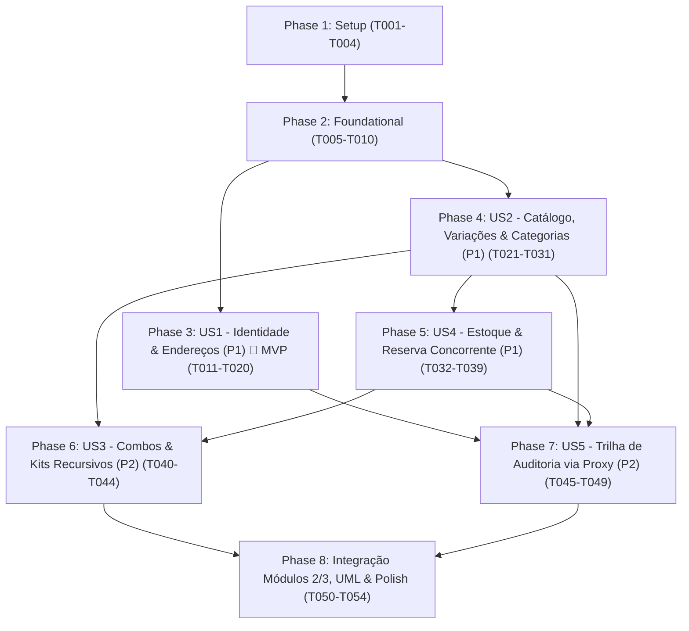

---

description: "Task list for Módulo 1 — Identidade, Catálogo, Composição de Produtos, Estoque e Auditoria"
---

# Tasks: Módulo 1 — Identidade, Catálogo, Composição de Produtos, Estoque e Auditoria

**Input**: Design documents from `/specs/001-catalogo-estoque-identidade/`

**Prerequisites**: [plan.md](./plan.md) (required), [spec.md](./spec.md) (required for user stories), [research.md](./research.md), [data-model.md](./data-model.md), [contracts/modulo1-api-and-integration-ports.md](./contracts/modulo1-api-and-integration-ports.md)

**Tests**: Incluídos obrigatoriamente conforme o Princípio VI da [Constituição](../../.specify/memory/constitution.md) (testes automatizados em JUnit 5 cobrindo os padrões de projeto, regras de negócio e concorrência de estoque).

**Regra Inegociável de Código (Princípio III da Constituição)**: Em **todas as tarefas abaixo**, absolutamente **todos os métodos** (públicos, protegidos e privados) DEVEM ser explícitos e possuir comentários (Javadoc e comentários internos nos passos do algoritmo) explicando: (1) objetivo funcional/comercial, (2) papel no Design Pattern correspondente e (3) parâmetros, retorno e exceções.

**Organization**: As tarefas estão agrupadas por User Story para permitir implementação, teste e demonstração independentes de cada entrega.

## Format: `[ID] [P?] [Story] Description`

- **[P]**: Pode ser executada em paralelo (arquivos diferentes, sem dependências pendentes)
- **[Story]**: Rastreabilidade direta para a User Story (`[US1]` a `[US5]`)
- Caminhos exatos de arquivo incluídos em todas as tarefas

---

## Phase 1: Setup (Shared Infrastructure)

**Purpose**: Inicialização do projeto Java 21 + Spring Boot 3.4 com Maven Wrapper e configuração global do Módulo 1

- [X] T001 Criar estrutura base do projeto Maven com Java 21, Spring Boot 3.4.x (`web`, `data-jpa`, `security`, `validation`), Springdoc OpenAPI 2, Flyway, PostgreSQL, H2 e JUnit 5 em `pom.xml`, `mvnw`, `mvnw.cmd` e `.gitignore`
- [X] T002 Criar classe principal da aplicação `EcommercePromocoesApplication` com comentários Javadoc explícitos em `src/main/java/br/edu/fatec/ecommerce/EcommercePromocoesApplication.java`
- [X] T003 [P] Configurar propriedades de execução (PostgreSQL / H2 em memória, Flyway e Swagger UI em `/swagger-ui.html`) em `src/main/resources/application.yml` e `src/main/resources/application-test.yml`
- [X] T004 [P] Implementar padrão `[Singleton]` thread-safe `ConfiguracaoModuloCatalogoEstoqueSingleton` (centralizando TTL padrão de expiração de reserva = 30 minutos, profundidade máxima de árvores recursivas = 10 níveis e moeda padrão `BRL`) em `src/main/java/br/edu/fatec/ecommerce/modulo1/configuracao/ConfiguracaoModuloCatalogoEstoqueSingleton.java`

---

## Phase 2: Foundational (Blocking Prerequisites)

**Purpose**: Infraestrutura compartilhada de banco de dados, tratamento de exceções, segurança base e estrutura de auditoria que bloqueia as User Stories

**⚠️ CRITICAL**: Nenhuma User Story pode ser iniciada antes da conclusão desta fase

- [X] T005 Criar migração SQL Flyway `V1__modulo1_identidade_catalogo_estoque_auditoria.sql` com as tabelas `usuarios`, `usuario_perfis`, `clientes`, `enderecos_cliente`, `categorias`, `produtos`, `variacoes_produto`, `atributos_variacao_flyweight`, `variacao_atributos_link`, `combos_kits`, `combo_kit_itens`, `itens_estoque`, `reservas_estoque`, `itens_reserva_estoque`, `movimentacoes_estoque` e `registros_auditoria` em `src/main/resources/db/migration/V1__modulo1_identidade_catalogo_estoque_auditoria.sql`
- [X] T006 [P] Implementar hierarquia de exceções de domínio (`RegraNegocioModulo1Exception`, `RecursoNaoEncontradoException`, `AcessoNegadoModulo1Exception`, `EstoqueInsuficienteException`, `CicloHierarquicoException`, `TransicaoEstadoReservaInvalidaException`) e handler REST `@RestControllerAdvice` em `src/main/java/br/edu/fatec/ecommerce/compartilhado/excecao/ManipuladorGlobalExcecoesRest.java`
- [X] T007 [P] Implementar enum `PerfilUsuario` (`CLIENTE`, `ADMIN`, `OPERADOR_COMERCIAL`, `RESPONSAVEL_ESTOQUE`, `RESPONSAVEL_PROMOCOES`) e utilitário explícito de contexto de autenticação `ContextoSegurancaUsuario` em `src/main/java/br/edu/fatec/ecommerce/modulo1/identidade/dominio/PerfilUsuario.java`
- [X] T008 Configurar Spring Security 6 (`BCryptPasswordEncoder`, autenticação HTTP Basic/Session e regras de autorização RBAC por rota e perfil) em `src/main/java/br/edu/fatec/ecommerce/compartilhado/seguranca/ConfiguracaoSegurancaHttp.java`
- [X] T009 [P] Implementar enum `TipoOperacaoAuditoria` (`ALTERACAO_PRECO_PRODUTO`, `ALTERACAO_PRECO_COMBO`, `CRIACAO_ALTERACAO_CATEGORIA`, `AJUSTE_MANUAL_ESTOQUE`, `ATIVACAO_INATIVACAO_ITEM`, `ALTERACAO_CAMPANHA`, `CANCELAMENTO_PEDIDO_ADMIN`) e entidade imutável `RegistroAuditoria` com `[Static Factory Method]` (`registrarAlteracaoPreco`, `registrarOperacaoCategoria`, `registrarAjusteEstoque`) em `src/main/java/br/edu/fatec/ecommerce/modulo1/auditoria/dominio/RegistroAuditoria.java`
- [X] T010 Implementar repositório JPA `RegistroAuditoriaJpaRepository` para persistência e consulta da trilha de auditoria em `src/main/java/br/edu/fatec/ecommerce/modulo1/auditoria/infraestrutura/RegistroAuditoriaJpaRepository.java`

**Checkpoint**: Fundação pronta — a implementação das User Stories já pode começar.

---

## Phase 3: User Story 1 - Cadastro, Autenticação, Autorização por Perfil e Gestão de Endereços (Priority: P1) 🎯 MVP

**Goal**: Permitir o auto-cadastro público exclusivo como `CLIENTE` com senha protegida por BCrypt, gestão de operadores internos restrita a `ADMIN`, controle de acesso por perfil e múltiplos endereços de entrega com padrão `Null Object` para endereço não selecionado e `Builder` para construção validada.

**Independent Test**: Cadastrar um cliente público, autenticar, consultar `/api/v1/clientes/me` verificando o retorno do `EnderecoAusenteNullObject`, cadastrar 3 endereços, selecionar um para entrega, criar operadores com o `ADMIN` inicial e validar bloqueio `403 Forbidden` quando um cliente ou operador tenta executar ação fora de seu perfil.

### Tests for User Story 1

- [X] T011 [P] [US1] Criar suíte de testes automatizados JUnit 5 para US1 (auto-cadastro fixando perfil `CLIENTE`, hash BCrypt irreversível, criação de operadores exclusiva por `ADMIN`, comportamento de `EnderecoAusenteNullObject`, `ClienteBuilder`/`EnderecoBuilder` e segregação de acesso RBAC) em `src/test/java/br/edu/fatec/ecommerce/modulo1/identidade/IdentidadeEnderecoIntegrationTest.java`

### Implementation for User Story 1

- [X] T012 [P] [US1] Implementar entidade `Usuario` (`id UUID`, `email VARCHAR(180)` único normalizado em minúsculas, `senhaHash VARCHAR(255)` obrigatório, `ativo BOOLEAN` padrão `true`, `perfis Set<PerfilUsuario>`) com `[Static Factory Method]` explícitos `criarContaClientePublico(...)` e `criarContaOperadorInterno(...)` em `src/main/java/br/edu/fatec/ecommerce/modulo1/identidade/dominio/Usuario.java`
- [X] T013 [P] [US1] Implementar interface `OpcaoEnderecoEntrega`, entidade `Endereco` (`apelido VARCHAR(60)`, `cep VARCHAR(8)` 8 dígitos numéricos, `logradouro VARCHAR(180)`, `numero VARCHAR(30)`, `complemento VARCHAR(100)` opcional, `bairro VARCHAR(100)`, `cidade VARCHAR(100)`, `uf CHAR(2)` sigla UF válida, `selecionadoParaEntrega BOOLEAN`) e classe `[Null Object / Missing Object]` `EnderecoAusenteNullObject` em `src/main/java/br/edu/fatec/ecommerce/modulo1/identidade/dominio/EnderecoAusenteNullObject.java`
- [X] T014 [P] [US1] Implementar `EnderecoBuilder` (`[Builder]` fluente e explícito validando formato de CEP de 8 dígitos, UF brasileira válida e campos obrigatórios no método `construir()`) em `src/main/java/br/edu/fatec/ecommerce/modulo1/identidade/dominio/EnderecoBuilder.java`
- [X] T015 [US1] Implementar entidade `Cliente` (`nomeCompleto VARCHAR(150)` mín. 3 caracteres, `cpf VARCHAR(11)` único com validação de dígitos, `telefone VARCHAR(20)`, `primeiraCompraConcluida BOOLEAN` padrão `false`, `obterEnderecoSelecionado()` retornando `OpcaoEnderecoEntrega` sem `null`) e `ClienteBuilder` (`[Builder]`) em `src/main/java/br/edu/fatec/ecommerce/modulo1/identidade/dominio/ClienteBuilder.java`
- [X] T016 [US1] Criar repositórios JPA `UsuarioJpaRepository`, `ClienteJpaRepository` e `EnderecoJpaRepository` em `src/main/java/br/edu/fatec/ecommerce/modulo1/identidade/infraestrutura/ClienteJpaRepository.java`
- [X] T017 [US1] Implementar `ServicoIdentidadeECliente` (auto-cadastro de cliente, autenticação, criação de operadores por `ADMIN`, CRUD de endereços e alternância de único endereço `selecionadoParaEntrega = true`) em `src/main/java/br/edu/fatec/ecommerce/modulo1/identidade/aplicacao/ServicoIdentidadeECliente.java`
- [X] T018 [US1] Implementar inicializador `InicializadorAdminPadraoRunner` para garantir a criação idempotente do usuário `ADMIN` inicial (`admin@ecommerce.fatec.edu.br`) na subida da aplicação em `src/main/java/br/edu/fatec/ecommerce/modulo1/identidade/infraestrutura/InicializadorAdminPadraoRunner.java`
- [X] T019 [P] [US1] Implementar controller REST `AutenticacaoEAdminUsuariosController` (`POST /api/v1/auth/clientes/cadastro`, `POST /api/v1/auth/login`, `POST /api/v1/admin/usuarios/operadores`) em `src/main/java/br/edu/fatec/ecommerce/modulo1/identidade/api/AutenticacaoEAdminUsuariosController.java`
- [X] T020 [P] [US1] Implementar controller REST `ClienteEnderecosController` (`GET /api/v1/clientes/me`, `POST /api/v1/clientes/me/enderecos`, `PUT /api/v1/clientes/me/enderecos/{enderecoId}/selecionar`, `DELETE /api/v1/clientes/me/enderecos/{enderecoId}`) em `src/main/java/br/edu/fatec/ecommerce/modulo1/identidade/api/ClienteEnderecosController.java`

**Checkpoint**: User Story 1 completa e independentemente testável (MVP de Identidade, Segurança e Endereços funcionando).

---

## Phase 4: User Story 2 - Catálogo de Produtos, Variações e Categorias Hierárquicas Recursivas (Priority: P1)

**Goal**: Estruturar o catálogo com árvore recursiva de categorias e subcategorias (`[Composite]` + `[Null Object]`), produtos com variações compartilhando atributos intrínsecos em memória (`[Flyweight]`) e criação extensível (`[Builder]`, `[Factory Method]`, `[Static Factory Method]`).

**Independent Test**: Criar uma árvore de categorias de 3 níveis (`Vestuário > Camisetas > Esportivas`), cadastrar produtos com variações (Tamanho P/M/G, Cor Preta/Branca), confirmar o reuso das mesmas instâncias `Flyweight` em memória e consultar produtos pela categoria pai `Vestuário` retornando automaticamente os itens de todas as subcategorias filhas.

### Tests for User Story 2

- [X] T021 [P] [US2] Criar suíte de testes JUnit 5 para US2 (navegação recursiva de `CategoriaComp`, bloqueio de ciclo hierárquico, comportamento de `CategoriaRaizNullObject`, compartilhamento de referência `assertSame` em `FabricaAtributoVariacaoFlyweight`, validação em `ProdutoBuilder` e `CriadorProdutoPadrao`) em `src/test/java/br/edu/fatec/ecommerce/modulo1/catalogo/CatalogoCategoriasVariacoesTest.java`

### Implementation for User Story 2

- [X] T022 [P] [US2] Implementar interface `ComponenteCategoria` (`[Composite - Component]`), classe `CategoriaRaizNullObject` (`[Null Object]`) e classe `CategoriaComp` (`[Composite]`, com `nome VARCHAR(100)` obrigatório, `slug VARCHAR(120)` único, verificação recursiva anti-ciclo `contemSubcategoriaNaArvore` e coleta recursiva `obterIdsSubarvoreRecursivo()`) em `src/main/java/br/edu/fatec/ecommerce/modulo1/catalogo/dominio/categoria/CategoriaComp.java`
- [X] T023 [P] [US2] Implementar enum `TipoAtributoVariacao` (`TAMANHO`, `COR`, `CAPACIDADE`, `VOLTAGEM`, `MATERIAL`, `ESPECIFICACAO`), classe imutável `AtributoVariacaoFlyweight` (`[Flyweight]`) e fábrica com pool compartilhado `FabricaAtributoVariacaoFlyweight` (`[Flyweight Factory]`) em `src/main/java/br/edu/fatec/ecommerce/modulo1/catalogo/dominio/flyweight/FabricaAtributoVariacaoFlyweight.java`
- [X] T024 [P] [US2] Implementar Value Object `DimensoesFisicas` (`pesoGramas INTEGER > 0`, `alturaCm NUMERIC(8,2) > 0`, `larguraCm NUMERIC(8,2) > 0`, `profundidadeCm NUMERIC(8,2) > 0`) com `[Static Factory Method]` explícito `emCentimetrosEGramas(...)` em `src/main/java/br/edu/fatec/ecommerce/modulo1/catalogo/dominio/item/DimensoesFisicas.java`
- [X] T025 [US2] Implementar interface `ItemCatalogoComponent` (`[Composite - Component]`), entidade `Produto` (`nome VARCHAR(160)`, `descricao TEXT`, `marca VARCHAR(100)`, `precoBase NUMERIC(15,2) > 0.00`, `atributosEspecificos Map<String,String>`, `ativo BOOLEAN`) e `ProdutoVariacaoLeaf` (`[Composite - Leaf]`, `sku VARCHAR(64)` único, `nomeVariacao VARCHAR(180)`, `adicionalPreco NUMERIC(15,2)` onde `precoBase + adicionalPreco > 0.00`, associada a `List<AtributoVariacaoFlyweight>`) em `src/main/java/br/edu/fatec/ecommerce/modulo1/catalogo/dominio/item/ProdutoVariacaoLeaf.java`
- [X] T026 [US2] Implementar `ProdutoBuilder` (`[Builder]` fluente para construção validada de `Produto` e suas variações `ProdutoVariacaoLeaf`) em `src/main/java/br/edu/fatec/ecommerce/modulo1/catalogo/dominio/item/ProdutoBuilder.java`
- [X] T027 [US2] Implementar hierarquia `[Factory Method]` com classe abstrata `CriadorItemCatalogo` e subclasse concreta `CriadorProdutoPadrao` em `src/main/java/br/edu/fatec/ecommerce/modulo1/catalogo/dominio/fabrica/CriadorProdutoPadrao.java`
- [X] T028 [US2] Criar repositórios JPA `CategoriaJpaRepository`, `ProdutoJpaRepository` e `VariacaoProdutoJpaRepository` em `src/main/java/br/edu/fatec/ecommerce/modulo1/catalogo/infraestrutura/ProdutoJpaRepository.java`
- [X] T029 [US2] Implementar `ServicoConsultaCatalogo`, interface `ServicoAdminCatalogoPort` e classe `ServicoAdminCatalogoReal` (criação de categorias, cadastro de produtos/variações, alteração de preço, ativação/inativação lógica de itens e busca recursiva por subcategorias) em `src/main/java/br/edu/fatec/ecommerce/modulo1/catalogo/aplicacao/ServicoAdminCatalogoReal.java`
- [X] T030 [P] [US2] Implementar controller público `CatalogoPublicoController` (`GET /api/v1/catalogo/categorias/arvore`, `GET /api/v1/catalogo/itens`, `GET /api/v1/catalogo/itens/{sku}`) em `src/main/java/br/edu/fatec/ecommerce/modulo1/catalogo/api/CatalogoPublicoController.java`
- [X] T031 [P] [US2] Implementar controller administrativo `CatalogoAdminController` (`POST /api/v1/admin/catalogo/categorias`, `POST /api/v1/admin/catalogo/produtos`, `PATCH /api/v1/admin/catalogo/itens/{sku}/preco`, `PATCH /api/v1/admin/catalogo/itens/{sku}/status`) em `src/main/java/br/edu/fatec/ecommerce/modulo1/catalogo/api/CatalogoAdminController.java`

**Checkpoint**: User Stories 1 e 2 funcionais e independentemente testáveis.

---

## Phase 5: User Story 4 - Controle Rigoroso de Estoque, Reserva Atômica e Prevenção de Concorrência (Priority: P1)

**Goal**: Controlar saldo disponível e reservado por SKU, realizar reserva atômica no fechamento de compra impedindo venda duplicada da última unidade em concorrência, expirar reservas vencidas (TTL padrão 30 min) e confirmar/liberar reservas de forma idempotente.

**Independent Test**: Configurar estoque de um SKU com 1 unidade, disparar 50 threads simultâneas tentando reservar essa última unidade, comprovar que exatamente 1 reserva é efetivada (`ATIVA`) e 49 recebem erro de estoque insuficiente, e validar que chamadas repetidas de liberação ou confirmação são idempotentes.

### Tests for User Story 4

- [X] T032 [P] [US4] Criar suíte de testes JUnit 5 de concorrência e idempotência para US4 (disputa multithread com `ExecutorService` e `CountDownLatch` pela última unidade em estoque, idempotência em chamadas duplicadas de confirmação/liberação, bloqueio de transição inválida e expiração automática por TTL) em `src/test/java/br/edu/fatec/ecommerce/modulo1/estoque/ReservaEstoqueConcorrenciaTest.java`

### Implementation for User Story 4

- [X] T033 [P] [US4] Implementar entidade `ItemEstoque` (`sku VARCHAR(64)` PK, `quantidadeDisponivel INTEGER >= 0`, `quantidadeReservada INTEGER >= 0`, `@Version versaoLock BIGINT`), enum `EstadoReservaEstoque` (`ATIVA`, `CONFIRMADA`, `LIBERADA`, `EXPIRADA`), `ItemReservaEstoque` e `MovimentacaoEstoque` (`[Static Factory Method]`) em `src/main/java/br/edu/fatec/ecommerce/modulo1/estoque/dominio/ItemEstoque.java`
- [X] T034 [P] [US4] Implementar agregado `ReservaEstoque` com `[Static Factory Method]` `criarReservaAtivaComExpiracao(...)` (`chaveOperacaoPedido VARCHAR(100)` única, `expiraEm` baseado no TTL do `Singleton`, e métodos explícitos de transição `confirmarBaixaDefinitiva()`, `liberarReserva()` e `expirarPorTtl()` com proteção idempotente) em `src/main/java/br/edu/fatec/ecommerce/modulo1/estoque/dominio/ReservaEstoque.java`
- [X] T035 [US4] Criar repositórios JPA `ItemEstoqueJpaRepository` (com query `@Lock(LockModeType.PESSIMISTIC_WRITE)` ordenada por SKU), `ReservaEstoqueJpaRepository` e `MovimentacaoEstoqueJpaRepository` em `src/main/java/br/edu/fatec/ecommerce/modulo1/estoque/infraestrutura/ItemEstoqueJpaRepository.java`
- [X] T036 [US4] Implementar `ServicoReservaEstoqueConcorrente` (reserva atômica com ordenação alfabética de SKUs contra deadlock, baixa definitiva idempotente, liberação idempotente por recusa/cancelamento e expurgo de reservas vencidas) em `src/main/java/br/edu/fatec/ecommerce/modulo1/estoque/aplicacao/ServicoReservaEstoqueConcorrente.java`
- [X] T037 [US4] Implementar interface `ServicoAdminEstoquePort` e classe `ServicoAdminEstoqueReal` para ajustes manuais e entradas de saldo físico em `src/main/java/br/edu/fatec/ecommerce/modulo1/estoque/aplicacao/ServicoAdminEstoqueReal.java`
- [X] T038 [P] [US4] Implementar controller `EstoqueReservaController` (`GET /api/v1/estoque/{sku}`, `POST /api/v1/estoque/reservas`, `POST /api/v1/estoque/reservas/{chaveOperacao}/confirmar`, `POST /api/v1/estoque/reservas/{chaveOperacao}/liberar`) em `src/main/java/br/edu/fatec/ecommerce/modulo1/estoque/api/EstoqueReservaController.java`
- [X] T039 [P] [US4] Implementar controller `EstoqueAdminController` (`POST /api/v1/admin/estoque/{sku}/ajustes`, `POST /api/v1/admin/estoque/reservas/expirar-vencidas`) em `src/main/java/br/edu/fatec/ecommerce/modulo1/estoque/api/EstoqueAdminController.java`

**Checkpoint**: Todas as User Stories de prioridade P1 (`US1`, `US2`, `US4`) concluídas e testáveis.

---

## Phase 6: User Story 3 - Composição de Produtos em Combos e Kits Comerciais (Priority: P2)

**Goal**: Permitir agrupar múltiplos produtos/variações (ou subkits aninhados, sem ciclos) em `ComboKitComposite` (`[Composite]`), calculando recursivamente peso, dimensões, disponibilidade pelo item gargalo e preço (soma recursiva com desconto opcional ou valor fixo dedicado).

**Independent Test**: Cadastrar um Combo exigindo 1 unidade do Produto A (estoque = 10) e 2 unidades do Produto B (estoque = 5), comprovar que a disponibilidade máxima do Combo é 2 unidades, validar o cálculo recursivo de preço/peso e testar a reserva atômica tudo-ou-nada do Combo.

### Tests for User Story 3

- [X] T040 [P] [US3] Criar suíte de testes JUnit 5 para US3 (`ComboKitComposite` com modos `SOMA_RECURSIVA_COMPONENTES` e `PRECO_FIXO_DEDICADO`, subkits aninhados, detecção de ciclo circular entre combos, cálculo de gargalo de estoque e reserva atômica tudo-ou-nada dos componentes) em `src/test/java/br/edu/fatec/ecommerce/modulo1/catalogo/ComboKitCompositeTest.java`

### Implementation for User Story 3

- [X] T041 [P] [US3] Implementar enum `ModoPrecoCombo` (`PRECO_FIXO_DEDICADO`, `SOMA_RECURSIVA_COMPONENTES`), classe `ItemComponenteKit` (`quantidadePorKit INTEGER >= 1`) e classe `ComboKitComposite` (`[Composite - Composite]`, `skuCombo VARCHAR(64)` único, `nomeCombo VARCHAR(160)`, `precoFixoOpcional NUMERIC(15,2) > 0.00`, `percentualDescontoKit NUMERIC(5,2)` entre `0.00` e `90.00`, implementando recursivamente `calcularPrecoVigente()`, `calcularDimensoesEPeso()`, `calcularDisponibilidadeMaximaEstoque()` e `decomporSkusFisicosParaReserva(int)`) em `src/main/java/br/edu/fatec/ecommerce/modulo1/catalogo/dominio/item/ComboKitComposite.java`
- [X] T042 [US3] Implementar `ComboKitBuilder` (`[Builder]` validando mínimo de 2 unidades/componentes, ausência de ciclos recursivos e consistência do modo de preço) e `CriadorComboKitPromocional` (`[Factory Method]`) em `src/main/java/br/edu/fatec/ecommerce/modulo1/catalogo/dominio/item/ComboKitBuilder.java`
- [X] T043 [US3] Criar `ComboKitJpaRepository` e integrar a decomposição recursiva de `ComboKitComposite` em `ServicoAdminCatalogoReal`, `ServicoConsultaCatalogo` e `ServicoReservaEstoqueConcorrente` em `src/main/java/br/edu/fatec/ecommerce/modulo1/catalogo/infraestrutura/ComboKitJpaRepository.java`
- [X] T044 [US3] Adicionar endpoint `POST /api/v1/admin/catalogo/combos` e suporte a alteração de preço de combos em `PATCH /api/v1/admin/catalogo/itens/{sku}/preco` em `src/main/java/br/edu/fatec/ecommerce/modulo1/catalogo/api/CatalogoAdminController.java`

**Checkpoint**: Catálogo suportando polimorficamente produtos simples, variações e Combos/Kits recursivos.

---

## Phase 7: User Story 5 - Trilha de Auditoria de Operações Administrativas Críticas (Priority: P2)

**Goal**: Interceptar de forma transparente todas as operações administrativas críticas via padrão `[Proxy]` (`CatalogoAdminAuditoriaProxy` e `EstoqueAdminSegurancaProxy`), validando o perfil do usuário e gravando registros imutáveis na trilha de auditoria consultável por `ADMIN`.

**Independent Test**: Alterar o preço de um produto com um `OPERADOR_COMERCIAL` e ajustar o saldo de estoque com um `RESPONSAVEL_ESTOQUE`, e em seguida consultar `GET /api/v1/admin/auditoria` como `ADMIN` verificando que ambos os eventos foram registrados automaticamente pelo Proxy com autor, perfil, data/hora e valores anterior e novo.

### Tests for User Story 5

- [X] T045 [P] [US5] Criar suíte de testes JUnit 5 para US5 (interceptação via `CatalogoAdminAuditoriaProxy` e `EstoqueAdminSegurancaProxy` gravando automaticamente `RegistroAuditoria` com estado anterior/novo, bloqueio de perfis não autorizados e consulta filtrada da trilha de auditoria) em `src/test/java/br/edu/fatec/ecommerce/modulo1/auditoria/AuditoriaProxyIntegrationTest.java`

### Implementation for User Story 5

- [X] T046 [P] [US5] Implementar `CatalogoAdminAuditoriaProxy` (`[Proxy - Protection & Audit Proxy]` envolvendo `ServicoAdminCatalogoReal` como `@Primary`, validando perfil `ADMIN`/`OPERADOR_COMERCIAL` e persistindo `RegistroAuditoria` antes/depois das operações de categoria, produto, preço, ativação/inativação de status e combo) em `src/main/java/br/edu/fatec/ecommerce/modulo1/catalogo/aplicacao/CatalogoAdminAuditoriaProxy.java`
- [X] T047 [P] [US5] Implementar `EstoqueAdminSegurancaProxy` (`[Proxy - Protection & Audit Proxy]` envolvendo `ServicoAdminEstoqueReal` como `@Primary`, validando perfil `ADMIN`/`RESPONSAVEL_ESTOQUE` e persistindo `RegistroAuditoria` nos ajustes de estoque) em `src/main/java/br/edu/fatec/ecommerce/modulo1/estoque/aplicacao/EstoqueAdminSegurancaProxy.java`
- [X] T048 [US5] Implementar `ServicoConsultaAuditoria` (filtros por usuário responsável, tipo de operação e intervalo de datas em ordem cronológica) em `src/main/java/br/edu/fatec/ecommerce/modulo1/auditoria/aplicacao/ServicoConsultaAuditoria.java`
- [X] T049 [US5] Implementar controller `AuditoriaAdminController` (`GET /api/v1/admin/auditoria` exclusivo para `ADMIN`) em `src/main/java/br/edu/fatec/ecommerce/modulo1/auditoria/api/AuditoriaAdminController.java`

**Checkpoint**: Todas as 5 User Stories do Módulo 1 concluídas e validadas.

---

## Phase 8: Polish, Portas de Integração (Módulos 2 e 3) & Documentação Arquitetural

**Purpose**: Exposição dos contratos de integração para os Integrantes 2 e 3 (`FR-013`), documentação UML e revisão final da regra inegociável de comentários em todos os métodos

- [X] T050 [P] Implementar DTOs de fronteira (`VisaoItemCatalogoDTO`, `VisaoClienteElegibilidadeDTO`, `ResumoReservaEstoqueDTO`) e interfaces `PortaConsultaCatalogoCliente` e `PortaComandoReservaEstoque` em `src/main/java/br/edu/fatec/ecommerce/modulo1/integracao/PortaConsultaCatalogoCliente.java` e `src/main/java/br/edu/fatec/ecommerce/modulo1/integracao/PortaComandoReservaEstoque.java`
- [X] T051 Implementar `AdaptadorIntegracaoModulo1Service` e seu teste de contrato JUnit 5 garantindo a integração limpa para os Módulos 2 (Carrinho/Promoções) e 3 (Checkout/Pedidos/Frete) em `src/main/java/br/edu/fatec/ecommerce/modulo1/integracao/AdaptadorIntegracaoModulo1Service.java`
- [X] T052 [P] Elaborar documento arquitetural e diagramas UML do Módulo 1 (Diagrama de Classes UML, Diagrama de Estados da Reserva, Diagramas de Sequência de Reserva Concorrente e Proxy de Auditoria, e Guia de Extensibilidade para alteração de requisito ao vivo na apresentação) em `docs/modulo1-arquitetura-e-padroes.md`
- [X] T053 Auditar 100% das classes e métodos em `src/main/java/br/edu/fatec/ecommerce/` garantindo conformidade total com o Princípio III da Constituição (todos os métodos explícitos e comentados com objetivo de negócio, papel no Design Pattern e parâmetros/retorno)
- [X] T054 Executar `.\mvnw.cmd clean test` e validar todos os 4 cenários ponta a ponta descritos em `specs/001-catalogo-estoque-identidade/quickstart.md`

---

## Dependencies & Execution Order

### Phase Dependencies



### User Story Dependencies

- **User Story 1 (P1 - Identidade, Perfis e Endereços)**: Depende apenas da Phase 2 (Foundational). Não depende de nenhuma outra User Story.
- **User Story 2 (P1 - Catálogo, Variações e Categorias)**: Depende da Phase 2 (Foundational). Pode ser desenvolvida em paralelo à US1.
- **User Story 4 (P1 - Estoque e Reserva Atômica Concorrente)**: Depende dos SKUs de `US2` para associar saldos e reservas.
- **User Story 3 (P2 - Combos e Kits Comerciais)**: Depende de `US2` (itens componentes) e `US4` (cálculo de disponibilidade pelo gargalo de estoque e reserva de múltiplos SKUs).
- **User Story 5 (P2 - Trilha de Auditoria via Proxy)**: Envolve os serviços administrativos de `US2`, `US3` e `US4` com `CatalogoAdminAuditoriaProxy` e `EstoqueAdminSegurancaProxy`.

---

## Parallel Opportunities & Examples

### Parallel Example 1: User Story 1 (Models & Builders)
```bash
# Podem ser implementadas simultaneamente em arquivos independentes:
Task T012: "Implementar entidade Usuario com Static Factory Methods em .../identidade/dominio/Usuario.java"
Task T013: "Implementar OpcaoEnderecoEntrega, Endereco e EnderecoAusenteNullObject em .../identidade/dominio/EnderecoAusenteNullObject.java"
Task T014: "Implementar EnderecoBuilder em .../identidade/dominio/EnderecoBuilder.java"
```

### Parallel Example 2: User Story 2 (Composite, Flyweight & Value Objects)
```bash
# Podem ser implementadas simultaneamente:
Task T022: "Implementar ComponenteCategoria, CategoriaRaizNullObject e CategoriaComp em .../catalogo/dominio/categoria/CategoriaComp.java"
Task T023: "Implementar AtributoVariacaoFlyweight e FabricaAtributoVariacaoFlyweight em .../catalogo/dominio/flyweight/FabricaAtributoVariacaoFlyweight.java"
Task T024: "Implementar DimensoesFisicas com Static Factory Method em .../catalogo/dominio/item/DimensoesFisicas.java"
```

### Parallel Example 3: User Story 5 (Protection & Audit Proxies)
```bash
# Podem ser implementadas simultaneamente:
Task T046: "Implementar CatalogoAdminAuditoriaProxy em .../catalogo/aplicacao/CatalogoAdminAuditoriaProxy.java"
Task T047: "Implementar EstoqueAdminSegurancaProxy em .../estoque/aplicacao/EstoqueAdminSegurancaProxy.java"
```

---

## Implementation Strategy

### 1. MVP First (User Story 1 + User Story 2 + User Story 4 — Núcleo P1)
1. Concluir **Phase 1 (Setup)** e **Phase 2 (Foundational)**.
2. Entregar **Phase 3 (US1)**: Autenticação BCrypt, perfis RBAC, `ClienteBuilder`, `EnderecoBuilder` e `EnderecoAusenteNullObject`.
3. Entregar **Phase 4 (US2)**: Categorias recursivas (`Composite` + `Null Object`), produtos e variações (`Flyweight`, `Builder`, `Factory Method`).
4. Entregar **Phase 5 (US4)**: Controle concorrente de estoque e reservas atômicas/idempotentes.

### 2. Incremental Delivery (Camadas P2 e Contratos de Equipe)
5. Entregar **Phase 6 (US3)**: `ComboKitComposite` (`Composite` + `Builder` + `Factory Method`) integrando cálculo recursivo de preço/peso/estoque.
6. Entregar **Phase 7 (US5)**: `CatalogoAdminAuditoriaProxy` e `EstoqueAdminSegurancaProxy` (`Proxy`) fechando 100% da trilha de auditoria.
7. Entregar **Phase 8 (Polish & Integração)**: Portas `PortaConsultaCatalogoCliente` e `PortaComandoReservaEstoque` para os Integrantes 2 e 3 + documentação UML de defesa.

---

## Phase 9: Convergence

- [X] T055 Implementar `ConfiguracaoOpenApiSwagger` (`@Configuration` definindo metadados OpenAPI 3 do Módulo 1 e esquema de segurança `basicAuth` para exibir o botão `Authorize` no Swagger UI, com todos os métodos explícitos e comentados) em `src/main/java/br/edu/fatec/ecommerce/compartilhado/config/ConfiguracaoOpenApiSwagger.java` per Constitution V (partial)
- [X] T056 Implementar `InicializadorDadosDemonstracaoModulo1Runner` (carga automática controlada por propriedade `ecommerce.modulo1.seed-demo-ativo` de árvore de categorias `Composite`, produtos com variações `Flyweight`, saldos de estoque e `ComboKitComposite` promocional para apresentação em memória) em `src/main/java/br/edu/fatec/ecommerce/modulo1/catalogo/infra/InicializadorDadosDemonstracaoModulo1Runner.java` per US2/US3/US4 (partial)
- [X] T057 Criar suíte de testes JUnit 5 validando o esquema OpenAPI `basicAuth` e a carga inicial de demonstração do Módulo 1 (alinhando também a credencial do admin em `specs/001-catalogo-estoque-identidade/quickstart.md`) em `src/test/java/br/edu/fatec/ecommerce/modulo1/integracao/SwaggerESeedDemonstracaoTest.java` per SC-004 (partial)


