# Data Model & UML: Módulo 2 — Carrinho, Motor de Promoções Avançadas, Elegibilidade, Cupons e Formação de Preço

**Feature**: `002-carrinho-promocoes-cupons`  
**Date**: 2026-11-03  
**Integrante 2**: Eduardo Juncker Toras  
**Status**: Completed  

---

## 1. Entidades de Domínio e Value Objects

### 1.1. Subdomínio `carrinho`

- **`CarrinhoCompras`**: Agregado raiz da sessão/conta de compra.
  - Atributos: `UUID id`, `UUID clienteId` (opcional/anônimo), `String sessaoId`, `List<ItemCarrinho> itens`, `CupomAplicado cupomAplicado`, `Instant atualizadoEm`.
  - Comportamentos: `adicionarOuIncrementarItem(...)`, `atualizarQuantidadeItem(...)`, `removerItem(...)`, `esvaziar()`, `calcularSubtotalBruto()`, `calcularPesoTotalGramas()`, `calcularQuantidadeTotalItens()`.
- **`ItemCarrinho` (Abstrata / `ElementoCarrinhoComponent`)**: Elemento visitável da estrutura do carrinho.
  - Atributos: `UUID id`, `String sku`, `String nome`, `BigDecimal precoUnitario`, `int quantidade`, `int pesoGramas`, `UUID categoriaId`.
  - Métodos polimórficos: `BigDecimal calcularSubtotalItem()`, `void aceitar(ElementoCarrinhoVisitor visitor)`.
- **`ItemCarrinhoProduto`**: Representa uma variação simples de produto individual (`ProdutoVariacaoLeaf` do Módulo 1).
- **`ItemCarrinhoComboKit`**: Representa um combo/kit composto (`ComboKitComposite` do Módulo 1), contendo seus componentes aninhados para fins de rateio ou elegibilidade.

### 1.2. Subdomínio `promocoes` (Motor e Elegibilidade)

- **`CampanhaPromocional`**: Regra de promoção comercial completa.
  - Atributos: `UUID id`, `String nome`, `String descricao`, `TipoMecanicaPromocao tipoMecanica`, `ParametrosMecanicaPromocao parametros`, `int prioridade`, `boolean cumulativa`, `boolean ativa`, `Instant dataInicio`, `Instant dataFim`, `CondicaoElegibilidadeComponent condicaoElegibilidade`.
  - Comportamentos: `boolean isVigenteNoMomento(Instant agora)`, `boolean isElegivel(ContextoElegibilidade contexto)`, `BigDecimal calcularDesconto(ContextoCalculoPromocao contexto)`.
  - Implementa: `Comparable<CampanhaPromocional>`.
- **`CondicaoElegibilidadeComponent` (Padrão Composite)**:
  - Método: `boolean avaliar(ContextoElegibilidade contexto)`.
  - Nós Folhas (*Leaves*):
    - `CondicaoValorMinimoCarrinho`: Verifica se o subtotal atinge determinado valor monetário.
    - `CondicaoPrimeiraCompraCliente`: Consulta no contexto se o cliente nunca concluiu uma compra.
    - `CondicaoCategoriaProduto`: Verifica se o carrinho contém itens pertencentes à categoria indicada (usando a porta do Módulo 1 para subcategorias recursivas).
    - `CondicaoItemEspecificoSku`: Verifica se determinado SKU está presente com quantidade mínima.
    - `CondicaoRegiaoEntrega`: Verifica a UF de entrega selecionada pelo cliente.
  - Nós Compostos (*Composites*):
    - `CondicaoAndComposite`: Avalia verdadeiro apenas se TODOS os filhos forem verdadeiros.
    - `CondicaoOrComposite`: Avalia verdadeiro se PELO MENOS UM filho for verdadeiro.
    - `CondicaoNotComposite`: Inverte o resultado booleano da condição filha.

### 1.3. Subdomínio `cupons`

- **`CupomPromocional`**: Cupom de desconto nominal ou percentual.
  - Atributos: `UUID id`, `String codigoAlfanumerico`, `TipoDescontoCupom tipo`, `BigDecimal valorDesconto`, `BigDecimal valorMinimoCarrinho`, `int quantidadeMaximaUsos`, `int quantidadeUsosAtuais`, `Instant expiraEm`, `boolean cumulativoComPromocoes`, `boolean ativo`.
  - Comportamentos: `boolean isDisponivelParaUso()`, `void registrarUso()`, `BigDecimal calcularDesconto(BigDecimal subtotalBase)`.
- **`CupomNulo` (Padrão Null Object)**: Representa a ausência segura de cupom no carrinho (`codigo = ""`, `desconto = BigDecimal.ZERO`, `isDisponivelParaUso() == false`).

### 1.4. Subdomínio `precificacao` (Formação de Preço e Decorator)

- **`PrecoCalculadoComponent`**: Interface base do Decorator de preço.
  - Métodos: `BigDecimal obterSubtotalBruto()`, `BigDecimal obterTotalLiquido()`, `List<ParcelaDescontoVO> obterDiscriminativoDescontos()`, `MemoriaCalculoPrecoVO gerarMemoriaCalculo()`.
- **`PrecoBaseCarrinho`**: Componente concreto que calcula o subtotal original bruto dos itens.
- **`DescontoDecoratorAbstrato`**: Classe abstrata decoradora que mantém referência ao `PrecoCalculadoComponent` embrulhado.
- **`DescontoPromocaoDecorator`**: Decorador que aplica o benefício da melhor promoção elegível com piso zero.
- **`DescontoCupomDecorator`**: Decorador que aplica o abatimento do cupom validado com piso zero.
- **`OperacoesMonetarias`**: Value Object estático com escala 2 e `HALF_EVEN` para todas as subtrações e percentuais.

---

## 2. Diagrama de Classes UML (Padrões do Módulo 2)

```mermaid
classDiagram
    direction TB

    %% COMPOSITE DE ELEGIBILIDADE
    class CondicaoElegibilidadeComponent {
        <<interface>>
        +avaliar(ContextoElegibilidade contexto) boolean
    }

    class CondicaoValorMinimoCarrinho {
        -BigDecimal valorMinimo
        +avaliar(ContextoElegibilidade contexto) boolean
    }

    class CondicaoPrimeiraCompraCliente {
        +avaliar(ContextoElegibilidade contexto) boolean
    }

    class CondicaoCategoriaProduto {
        -UUID categoriaId
        +avaliar(ContextoElegibilidade contexto) boolean
    }

    class CondicaoAndComposite {
        -List~CondicaoElegibilidadeComponent~ condicoes
        +adicionar(CondicaoElegibilidadeComponent c)
        +avaliar(ContextoElegibilidade contexto) boolean
    }

    class CondicaoOrComposite {
        -List~CondicaoElegibilidadeComponent~ condicoes
        +adicionar(CondicaoElegibilidadeComponent c)
        +avaliar(ContextoElegibilidade contexto) boolean
    }

    class CondicaoNotComposite {
        -CondicaoElegibilidadeComponent condicaoFilha
        +avaliar(ContextoElegibilidade contexto) boolean
    }

    CondicaoElegibilidadeComponent <|.. CondicaoValorMinimoCarrinho
    CondicaoElegibilidadeComponent <|.. CondicaoPrimeiraCompraCliente
    CondicaoElegibilidadeComponent <|.. CondicaoCategoriaProduto
    CondicaoElegibilidadeComponent <|.. CondicaoAndComposite
    CondicaoElegibilidadeComponent <|.. CondicaoOrComposite
    CondicaoElegibilidadeComponent <|.. CondicaoNotComposite
    CondicaoAndComposite o-- CondicaoElegibilidadeComponent
    CondicaoOrComposite o-- CondicaoElegibilidadeComponent
    CondicaoNotComposite o-- CondicaoElegibilidadeComponent

    %% VISITOR & DOUBLE DISPATCH
    class ElementoCarrinhoComponent {
        <<interface>>
        +aceitar(ElementoCarrinhoVisitor visitor) void
        +obterSubtotal() BigDecimal
    }

    class ItemCarrinhoProduto {
        -String sku
        -BigDecimal precoUnitario
        -int quantidade
        +aceitar(ElementoCarrinhoVisitor visitor) void
    }

    class ItemCarrinhoComboKit {
        -String skuCombo
        -List~ItemCarrinhoProduto~ componentes
        +aceitar(ElementoCarrinhoVisitor visitor) void
    }

    class ElementoCarrinhoVisitor {
        <<interface>>
        +visitarProduto(ItemCarrinhoProduto produto) void
        +visitarComboKit(ItemCarrinhoComboKit combo) void
    }

    class CalculadoraDescontoVisitor {
        -BigDecimal descontoCalculado
        +visitarProduto(ItemCarrinhoProduto produto) void
        +visitarComboKit(ItemCarrinhoComboKit combo) void
        +obterDescontoTotal() BigDecimal
    }

    ElementoCarrinhoComponent <|.. ItemCarrinhoProduto
    ElementoCarrinhoComponent <|.. ItemCarrinhoComboKit
    ElementoCarrinhoVisitor <|.. CalculadoraDescontoVisitor
    ItemCarrinhoProduto ..> ElementoCarrinhoVisitor : "aceitar(visitor) -> visitor.visitarProduto(this)"
    ItemCarrinhoComboKit ..> ElementoCarrinhoVisitor : "aceitar(visitor) -> visitor.visitarComboKit(this)"

    %% DECORATOR DE FORMACAO DE PRECO
    class PrecoCalculadoComponent {
        <<interface>>
        +obterSubtotalBruto() BigDecimal
        +obterTotalLiquido() BigDecimal
        +obterDiscriminativoDescontos() List~ParcelaDescontoVO~
    }

    class PrecoBaseCarrinho {
        -BigDecimal subtotal
        +obterSubtotalBruto() BigDecimal
        +obterTotalLiquido() BigDecimal
        +obterDiscriminativoDescontos() List~ParcelaDescontoVO~
    }

    class DescontoDecoratorAbstrato {
        <<abstract>>
        #PrecoCalculadoComponent decorado
        +obterSubtotalBruto() BigDecimal
    }

    class DescontoPromocaoDecorator {
        -CampanhaPromocional promocao
        -BigDecimal valorDesconto
        +obterTotalLiquido() BigDecimal
        +obterDiscriminativoDescontos() List~ParcelaDescontoVO~
    }

    class DescontoCupomDecorator {
        -CupomPromocional cupom
        -BigDecimal valorDesconto
        +obterTotalLiquido() BigDecimal
        +obterDiscriminativoDescontos() List~ParcelaDescontoVO~
    }

    PrecoCalculadoComponent <|.. PrecoBaseCarrinho
    PrecoCalculadoComponent <|.. DescontoDecoratorAbstrato
    DescontoDecoratorAbstrato o-- PrecoCalculadoComponent
    DescontoDecoratorAbstrato <|-- DescontoPromocaoDecorator
    DescontoDecoratorAbstrato <|-- DescontoCupomDecorator

    %% COMPARABLE & DYNAMIC FACTORY
    class CampanhaPromocional {
        -String nome
        -int prioridade
        -boolean cumulativa
        +compareTo(CampanhaPromocional outra) int
        +calcularDesconto(ContextoCalculoPromocao ctx) BigDecimal
    }

    class FabricaDinamicaEstrategiaPromocao {
        -Map~TipoMecanicaPromocao, EstrategiaCalculoPromocao~ estrategias
        +obterEstrategia(TipoMecanicaPromocao tipo) EstrategiaCalculoPromocao
    }
```

---

## 3. Modelo de Dados Relacional (Flyway V2)

Para persistir as entidades do Módulo 2 no mesmo banco relacional:

1. **`tb_carrinho`**: `id (UUID PK)`, `cliente_id (UUID)`, `sessao_id (VARCHAR)`, `atualizado_em (TIMESTAMP)`.
2. **`tb_item_carrinho`**: `id (UUID PK)`, `carrinho_id (UUID FK)`, `sku (VARCHAR)`, `nome (VARCHAR)`, `tipo_item (VARCHAR)`, `preco_unitario (NUMERIC)`, `quantidade (INT)`, `peso_gramas (INT)`, `categoria_id (UUID)`.
3. **`tb_campanha_promocional`**: `id (UUID PK)`, `nome (VARCHAR)`, `descricao (TEXT)`, `tipo_mecanica (VARCHAR)`, `parametros_json (TEXT)`, `prioridade (INT)`, `cumulativa (BOOLEAN)`, `ativa (BOOLEAN)`, `data_inicio (TIMESTAMP)`, `data_fim (TIMESTAMP)`, `arvore_elegibilidade_json (TEXT)`.
4. **`tb_cupom_promocional`**: `id (UUID PK)`, `codigo (VARCHAR UNIQUE)`, `tipo_desconto (VARCHAR)`, `valor_desconto (NUMERIC)`, `valor_minimo_carrinho (NUMERIC)`, `qtd_max_usos (INT)`, `qtd_usos_atuais (INT)`, `expira_em (TIMESTAMP)`, `cumulativo (BOOLEAN)`, `ativo (BOOLEAN)`.

