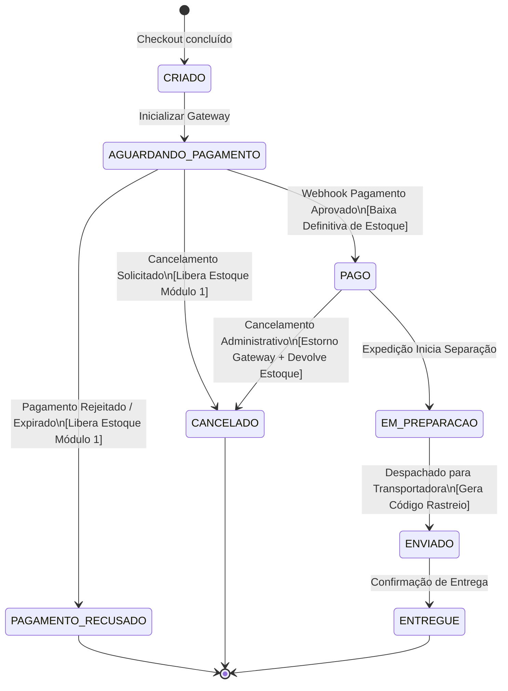
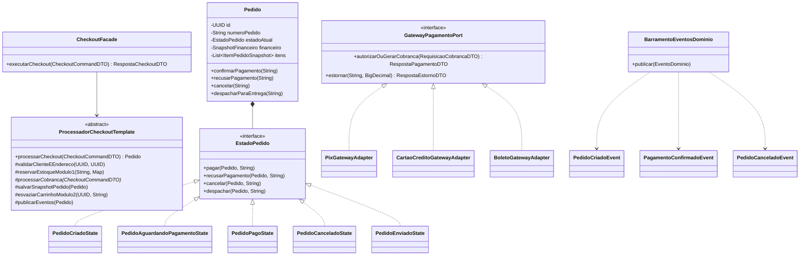

# Data Model & UML: Módulo 3 — Checkout, Ciclo de Vida de Pedidos, Pagamentos Idempotentes, Frete, Notificações e Relatórios Gerenciais

**Feature**: `003-checkout-pedidos-pagamentos`  
**Date**: 2026-11-11  
**Integrante 3**: Henrique Sandrini  
**Status**: Completed  

---

## 1. Entidades de Domínio e Value Objects

### 1.1. Subdomínio `pedido` (Agregado Raiz e Ciclo de Vida)

- **`Pedido`**: Agregado raiz da transação de compra concluída.
  - **Atributos**:
    - `UUID id`: Identificador único universal.
    - `String numeroPedido`: Código amigável e sequencial da compra (ex.: `PED-202611-0001`).
    - `UUID clienteId`: Referência ao cliente no Módulo 1.
    - `EnderecoEntregaSnapshot enderecoEntrega`: Value Object contendo o endereço congelado no momento da compra.
    - `SnapshotFinanceiro financeiro`: Memória financeira imutável da transação.
    - `MetodoPagamento metodoPagamento`: Modalidade selecionada (`PIX`, `CARTAO_CREDITO`, `BOLETO`).
    - `String modalidadeFrete`: Nome da opção de entrega escolhida (`PAC`, `SEDEX`, `EXPRESSA`).
    - `int prazoEntregaDiasUteis`: Prazo de transporte garantido na cotação.
    - `String codigoRastreio`: Código de rastreamento logístico gerado no envio.
    - `String chaveOperacaoEstoque`: Chave única utilizada para reserva e baixa atômica no Módulo 1.
    - `EstadoPedido estadoAtual`: Referência polimórfica à instância de estado atual (`State`).
    - `String motivoCancelamento`: Justificativa gravada caso o pedido seja cancelado.
    - `Instant criadoEm`: Data e hora exata da emissão do pedido.
    - `Instant atualizadoEm`: Data e hora da última transição de estado.
  - **Comportamentos**:
    - `void confirmarPagamento(String transacaoId)`: Dispara transição para `PAGO`.
    - `void recusarPagamento(String motivo)`: Dispara transição para `PAGAMENTO_RECUSADO`.
    - `void iniciarPreparacao()`: Transita de `PAGO` para `EM_PREPARACAO`.
    - `void despacharParaEntrega(String codigoRastreio)`: Transita para `ENVIADO`.
    - `void confirmarEntrega()`: Transita para `ENTREGUE`.
    - `void cancelar(String motivo)`: Transita para `CANCELADO` (se permitido).

- **`ItemPedidoSnapshot`**: Linha imutável dos itens que compõem o pedido.
  - **Atributos**:
    - `UUID id`: Identificador da linha.
    - `Pedido pedido`: Referência ao pedido pai.
    - `String sku`: Código único do produto/variação ou combo no catálogo.
    - `String nome`: Descrição do item congelada na data da compra.
    - `String tipoItem`: `PRODUTO` ou `COMBO_KIT`.
    - `BigDecimal precoUnitarioTabela`: Preço de tabela original sem descontos.
    - `int quantidade`: Unidades compradas.
    - `BigDecimal descontoUnitarioRateado`: Parcela de desconto concedida pelas campanhas e cupons.
    - `BigDecimal subtotalLiquido`: Valor final efetivamente cobrado pela linha (`(precoUnitario - descontoUnitario) * quantidade`).
    - `int pesoTotalGramas`: Peso agregado da linha.

- **`EnderecoEntregaSnapshot`** (Value Object Imutável):
  - Atributos: `String apelido`, `String cep`, `String logradouro`, `String numero`, `String complemento`, `String bairro`, `String cidade`, `String uf`.

- **`SnapshotFinanceiro`** (Value Object Imutável):
  - Atributos: `BigDecimal subtotalBruto`, `BigDecimal totalDescontosPromocoes`, `BigDecimal totalDescontoCupom`, `BigDecimal valorFrete`, `boolean freteGratis`, `BigDecimal valorTotalLiquido`.

---

### 1.2. Máquina de Estados do Pedido (Padrão GoF `State`)

A interface `EstadoPedido` define o contrato polimórfico de comportamento para cada estado:

```java
public interface EstadoPedido {
    StatusPedido getStatus();
    void pagar(Pedido pedido, String transacaoId);
    void recusarPagamento(Pedido pedido, String motivo);
    void preparar(Pedido pedido);
    void despachar(Pedido pedido, String codigoRastreio);
    void entregar(Pedido pedido);
    void cancelar(Pedido pedido, String motivo);
}
```

**Classes Concretas de Estado**:
1. `PedidoCriadoState`: Estado inicial recém-persistido no checkout.
2. `PedidoAguardandoPagamentoState`: Pedido registrado aguardando a confirmação do webhook financeiro.
3. `PedidoPagoState`: Pagamento aprovado, estoque com baixa definitiva confirmada.
4. `PedidoEmPreparacaoState`: Em separação física no estoque/expedição.
5. `PedidoEnviadoState`: Pedido entregue à transportadora com código de rastreio.
6. `PedidoEntregueState`: Pedido entregue ao cliente (estado terminal com sucesso).
7. `PedidoCanceladoState`: Pedido cancelado e estornado (estado terminal).
8. `PedidoPagamentoRecusadoState`: Pagamento não aprovado pela instituição financeira (estado terminal).

---

### 1.3. Subdomínio `pagamento` e Idempotência

- **`TransacaoPagamento`**: Entidade de registro da liquidação financeira.
  - Atributos: `UUID id`, `UUID pedidoId`, `String chaveIdempotencia`, `MetodoPagamento metodo`, `BigDecimal valor`, `StatusTransacaoPagamento status`, `String identificadorGateway`, `String comprovanteOuQrCode`, `Instant processadoEm`.
- **`RegistroIdempotenciaPagamento`**: Tabela de bloqueio de concorrência e idempotência.
  - Atributos:
    - `String chaveOperacao`: Chave natural primária enviada pelo webhook ou cliente (`@Id`, `VARCHAR(120)`).
    - `String statusResposta`: Status gravado (`PROCESSADO_SUCESSO`, `PROCESSADO_RECUSA`).
    - `String payloadRespostaJson`: Cache do JSON retornado para repetição idêntica.
    - `Instant registradoEm`: Timestamp da primeira execução.

---

### 1.4. Subdomínio `frete` (Logística de Entrega)

- **`CotacaoFrete`** (Value Object):
  - Atributos: `String modalidade`, `String nomeExibicao`, `String transportadora`, `BigDecimal valorOriginal`, `BigDecimal valorCobrado`, `boolean freteGratisAplicado`, `int prazoDiasUteis`.

---

## 2. Diagrama de Estados do Ciclo de Vida do Pedido (Mermaid)



---

## 3. Diagrama de Classes e Arquitetura de Padrões (Mermaid)



---

## 4. Esquema Relacional de Banco de Dados (Flyway Migration `V3`)

A migração `V3__modulo3_checkout_pedidos_pagamentos_frete.sql` cria as seguintes tabelas:

```sql
-- 1. Tabela Principal de Pedidos
CREATE TABLE tb_pedidos (
    id UUID PRIMARY KEY,
    numero_pedido VARCHAR(40) NOT NULL UNIQUE,
    cliente_id UUID NOT NULL,
    status VARCHAR(30) NOT NULL,
    metodo_pagamento VARCHAR(30) NOT NULL,
    modalidade_frete VARCHAR(50) NOT NULL,
    prazo_entrega_dias INTEGER NOT NULL,
    codigo_rastreio VARCHAR(60),
    chave_operacao_estoque VARCHAR(120) NOT NULL UNIQUE,
    subtotal_bruto NUMERIC(15,2) NOT NULL,
    total_descontos NUMERIC(15,2) NOT NULL,
    valor_frete NUMERIC(15,2) NOT NULL,
    frete_gratis BOOLEAN NOT NULL DEFAULT FALSE,
    valor_total_liquido NUMERIC(15,2) NOT NULL,
    motivo_cancelamento VARCHAR(255),
    endereco_apelido VARCHAR(60),
    endereco_cep VARCHAR(8) NOT NULL,
    endereco_logradouro VARCHAR(180) NOT NULL,
    endereco_numero VARCHAR(30) NOT NULL,
    endereco_complemento VARCHAR(100),
    endereco_bairro VARCHAR(100) NOT NULL,
    endereco_cidade VARCHAR(100) NOT NULL,
    endereco_uf CHAR(2) NOT NULL,
    criado_em TIMESTAMP WITH TIME ZONE NOT NULL,
    atualizado_em TIMESTAMP WITH TIME ZONE NOT NULL
);

-- 2. Linhas do Snapshot Comercial do Pedido
CREATE TABLE tb_itens_pedido_snapshot (
    id UUID PRIMARY KEY,
    pedido_id UUID NOT NULL REFERENCES tb_pedidos(id) ON DELETE CASCADE,
    sku VARCHAR(64) NOT NULL,
    nome VARCHAR(180) NOT NULL,
    tipo_item VARCHAR(30) NOT NULL,
    preco_unitario_tabela NUMERIC(15,2) NOT NULL,
    quantidade INTEGER NOT NULL,
    desconto_unitario NUMERIC(15,2) NOT NULL DEFAULT 0.00,
    subtotal_liquido NUMERIC(15,2) NOT NULL,
    peso_total_gramas INTEGER NOT NULL
);

-- 3. Transações Financeiras do Pedido
CREATE TABLE tb_transacoes_pagamento (
    id UUID PRIMARY KEY,
    pedido_id UUID NOT NULL REFERENCES tb_pedidos(id),
    chave_idempotencia VARCHAR(120) NOT NULL UNIQUE,
    metodo VARCHAR(30) NOT NULL,
    valor NUMERIC(15,2) NOT NULL,
    status VARCHAR(30) NOT NULL,
    identificador_gateway VARCHAR(120),
    comprovante_ou_qrcode TEXT,
    processado_em TIMESTAMP WITH TIME ZONE NOT NULL
);

-- 4. Tabela de Idempotência Estrita para Webhooks e Chamadas Repetidas
CREATE TABLE tb_registro_idempotencia_pagamento (
    chave_operacao VARCHAR(120) PRIMARY KEY,
    status_resposta VARCHAR(40) NOT NULL,
    payload_resposta_json TEXT NOT NULL,
    registrado_em TIMESTAMP WITH TIME ZONE NOT NULL
);

CREATE INDEX idx_pedidos_cliente ON tb_pedidos(cliente_id);
CREATE INDEX idx_pedidos_status ON tb_pedidos(status);
CREATE INDEX idx_itens_pedido_sku ON tb_itens_pedido_snapshot(sku);
```
