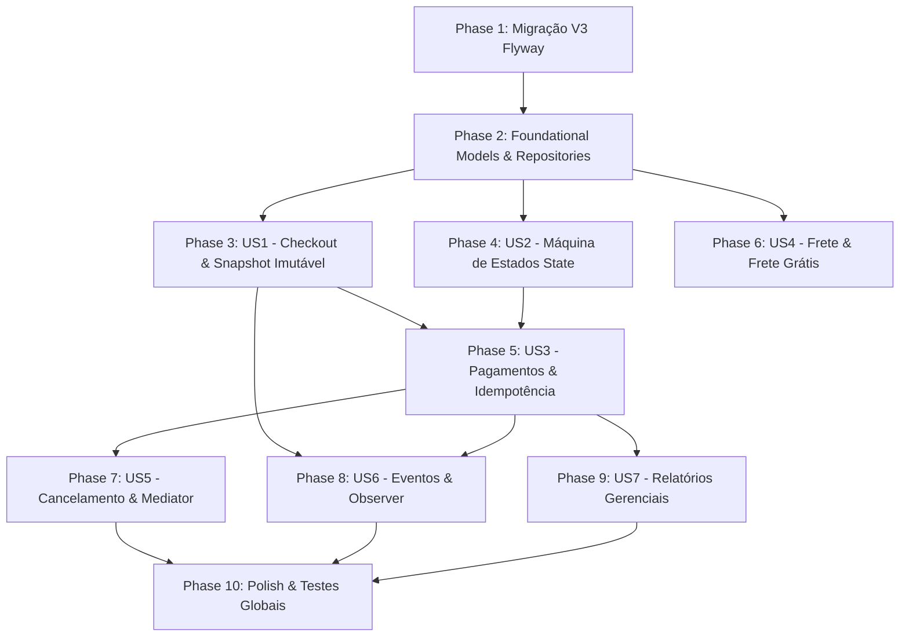

---

description: "Task list for Módulo 3 — Checkout, Ciclo de Vida de Pedidos, Pagamentos Idempotentes, Frete, Notificações e Relatórios Gerenciais"
---

# Tasks: Módulo 3 — Checkout, Ciclo de Vida de Pedidos, Pagamentos Idempotentes, Frete, Notificações e Relatórios Gerenciais

**Input**: Design documents from `/specs/003-checkout-pedidos-pagamentos/`  
**Prerequisites**: [plan.md](./plan.md) (required), [spec.md](./spec.md) (required for user stories), [research.md](./research.md), [data-model.md](./data-model.md), [contracts/modulo3-api-and-integration-ports.md](./contracts/modulo3-api-and-integration-ports.md)  
**Integrante 3**: Henrique Sandrini  
**Tests**: Incluídos obrigatoriamente conforme o Princípio VI da [Constituição](../../.specify/memory/constitution.md) (testes automatizados em JUnit 5 cobrindo os 7 padrões de projeto GoF, idempotência estrita, transições ilegais do ciclo de vida, cálculo de frete grátis e cancelamento com liberação de estoque).  

**Regra Inegociável de Código (Princípio III da Constituição)**: Em **todas as tarefas abaixo**, absolutamente **todos os métodos** (públicos, protegidos e privados) DEVEM ser explícitos e possuir comentários (Javadoc e comentários internos nos passos do algoritmo) explicando: (1) objetivo funcional/comercial, (2) papel no Design Pattern correspondente e (3) parâmetros, retorno e exceções.

**Organization**: As tarefas estão agrupadas por User Story para permitir implementação, teste e demonstração independentes de cada entrega.

## Format: `[ID] [P?] [Story] Description`

- **[P]**: Pode ser executada em paralelo (arquivos diferentes, sem dependências pendentes)
- **[Story]**: Rastreabilidade direta para a User Story (`[US1]` a `[US7]`)
- Caminhos exatos de arquivo incluídos em todas as tarefas

---

## Phase 1: Setup & Migração de Banco de Dados (Módulo 3)

**Purpose**: Criação do esquema relacional de persistência para pedidos, snapshots, transações financeiras e tabela de idempotência

- [X] T001 Criar migração SQL Flyway `V3__modulo3_checkout_pedidos_pagamentos_frete.sql` contendo as tabelas `tb_pedidos`, `tb_itens_pedido_snapshot`, `tb_transacoes_pagamento`, `tb_registro_idempotencia_pagamento` e seus índices em `src/main/resources/db/migration/V3__modulo3_checkout_pedidos_pagamentos_frete.sql`

---

## Phase 2: Foundational (Blocking Prerequisites)

**Purpose**: Value Objects, exceções de domínio, enums e repositórios JPA compartilhados que bloqueiam todas as User Stories

**⚠️ CRITICAL**: Nenhuma User Story pode ser iniciada antes da conclusão desta fase

- [X] T002 [P] Implementar enums de domínio `StatusPedido` (`CRIADO`, `AGUARDANDO_PAGAMENTO`, `PAGO`, `EM_PREPARACAO`, `ENVIADO`, `ENTREGUE`, `CANCELADO`, `PAGAMENTO_RECUSADO`), `MetodoPagamento` (`PIX`, `CARTAO_CREDITO`, `BOLETO`), `StatusTransacaoPagamento` (`PENDENTE`, `CONFIRMADA`, `RECUSADA`, `ESTORNADA`) e `ModalidadeFrete` em `src/main/java/br/edu/fatec/ecommerce/modulo3/pedido/dominio/StatusPedido.java`
- [X] T003 [P] Implementar exceções de domínio `RegraNegocioModulo3Exception`, `TransicaoEstadoInvalidaException`, `PedidoNaoEncontradoException` e `PagamentoInvalidoException` com tratamento no `@RestControllerAdvice` em `src/main/java/br/edu/fatec/ecommerce/modulo3/compartilhado/excecao/TransicaoEstadoInvalidaException.java`
- [X] T004 [P] Implementar Value Objects imutáveis `EnderecoEntregaSnapshot` e `SnapshotFinanceiro` em `src/main/java/br/edu/fatec/ecommerce/modulo3/pedido/dominio/EnderecoEntregaSnapshot.java` e `src/main/java/br/edu/fatec/ecommerce/modulo3/pedido/dominio/SnapshotFinanceiro.java`
- [X] T005 [P] Implementar entidade `ItemPedidoSnapshot` (linha imutável do pedido registrando SKU, nome, preços vigentes, rateio de descontos e peso) em `src/main/java/br/edu/fatec/ecommerce/modulo3/pedido/dominio/ItemPedidoSnapshot.java`
- [X] T006 Implementar repositórios JPA `PedidoJpaRepository`, `ItemPedidoSnapshotJpaRepository`, `TransacaoPagamentoJpaRepository` e `RegistroIdempotenciaJpaRepository` em `src/main/java/br/edu/fatec/ecommerce/modulo3/pedido/infraestrutura/PedidoJpaRepository.java`

**Checkpoint**: Fundação pronta — implementação das User Stories liberada.

---

## Phase 3: User Story 1 - Orquestração de Checkout e Snapshot Comercial Imutável (Priority: P1) 🎯 MVP

**Goal**: Permitir que um cliente autenticado execute o fechamento de compra via `CheckoutFacade` (`[Facade]`) e `ProcessadorCheckoutTemplate` (`[Template Method]`), validando endereço no Módulo 1, resumo promocional no Módulo 2, reservando estoque atomicamente e persistindo o pedido com snapshot imutável.

### Tests for User Story 1

- [X] T007 [P] [US1] Criar testes unitários e de integração JUnit 5 para o checkout (validação de cliente/endereço via Módulo 1, congelamento de itens do Módulo 2, chamada de reserva na `PortaComandoReservaEstoque`, esvaziamento do carrinho e criação do pedido imutável com status inicial) em `src/test/java/br/edu/fatec/ecommerce/modulo3/checkout/CheckoutFacadeIntegrationTest.java`

### Implementation for User Story 1

- [X] T008 [P] [US1] Implementar DTOs de comando e resposta `CheckoutRequestDTO` e `CheckoutResponseDTO` em `src/main/java/br/edu/fatec/ecommerce/modulo3/checkout/api/dto/CheckoutRequestDTO.java`
- [X] T009 [US1] Implementar classe abstrata `[Template Method]` `ProcessadorCheckoutTemplate` definindo o fluxo invariante (`validarClienteEEndereco` -> `obterResumoCarrinho` -> `reservarEstoqueModulo1` -> `processarCobranca` -> `criarESalvarPedido` -> `esvaziarCarrinhoModulo2` -> `publicarEventoCriacao`) com métodos hook para especializações em `src/main/java/br/edu/fatec/ecommerce/modulo3/checkout/aplicacao/ProcessadorCheckoutTemplate.java`
- [X] T010 [US1] Implementar fachada `[Facade]` `CheckoutFacade` orquestrando o fechamento de compra em `src/main/java/br/edu/fatec/ecommerce/modulo3/checkout/aplicacao/CheckoutFacade.java`
- [X] T011 [P] [US1] Implementar controller REST `CheckoutController` (`POST /api/v1/checkout`) com autenticação do cliente em `src/main/java/br/edu/fatec/ecommerce/modulo3/checkout/api/CheckoutController.java`

**Checkpoint**: User Story 1 completa e independentemente testável (MVP de Checkout gerando pedidos com snapshot imutável).

---

## Phase 4: User Story 2 - Máquina de Estados do Ciclo de Vida do Pedido com Padrão State (Priority: P1)

**Goal**: Modelar o ciclo de vida do agregado `Pedido` com o padrão `[State]`, controlando rigorosamente as transições válidas e bloqueando operações ilegais com `TransicaoEstadoInvalidaException`.

### Tests for User Story 2

- [X] T012 [P] [US2] Criar testes JUnit 5 para a máquina de estados (transições válidas completas `CRIADO` -> `AGUARDANDO_PAGAMENTO` -> `PAGO` -> `EM_PREPARACAO` -> `ENVIADO` -> `ENTREGUE` e bloqueio de transições inválidas como cancelar pedido despachado ou pagar pedido cancelado) em `src/test/java/br/edu/fatec/ecommerce/modulo3/pedido/MaquinaEstadosPedidoTest.java`

### Implementation for User Story 2

- [X] T013 [P] [US2] Implementar interface `[State]` `EstadoPedido` e as 8 classes concretas de estado: `PedidoCriadoState`, `PedidoAguardandoPagamentoState`, `PedidoPagoState`, `PedidoEmPreparacaoState`, `PedidoEnviadoState`, `PedidoEntregueState`, `PedidoCanceladoState` e `PedidoPagamentoRecusadoState` em `src/main/java/br/edu/fatec/ecommerce/modulo3/pedido/dominio/estado/EstadoPedido.java`
- [X] T014 [US2] Implementar agregado raiz `Pedido` integrando o padrão `[State]` com persistência de status e métodos semânticos de transição de estado em `src/main/java/br/edu/fatec/ecommerce/modulo3/pedido/dominio/Pedido.java`
- [X] T015 [US2] Implementar `ServicoConsultaPedido` (consulta de pedidos do cliente autenticado e consulta por ID com validação de permissão) em `src/main/java/br/edu/fatec/ecommerce/modulo3/pedido/aplicacao/ServicoConsultaPedido.java`
- [X] T016 [P] [US2] Implementar controllers REST `PedidoClienteController` (`GET /api/v1/pedidos/me`, `GET /api/v1/pedidos/{id}`) e `PedidoAdminController` (`PATCH /api/v1/admin/pedidos/{id}/despachar`, `PATCH /api/v1/admin/pedidos/{id}/entregar`) em `src/main/java/br/edu/fatec/ecommerce/modulo3/pedido/api/PedidoClienteController.java`

**Checkpoint**: User Story 2 completa e testável (máquina de estados do ciclo de vida funcionando e blindada).

---

## Phase 5: User Story 3 - Pagamentos Simulados com Idempotência Estrita (Priority: P1)

**Goal**: Implementar adaptadores `[Adapter]` / Camada Anticorrupção (ACL) para PIX, Cartão e Boleto, resolução dinâmica via `[Abstract Factory]` / `[Service Locator]` e webhook de confirmação com garantia estrita de **idempotência** (`tb_registro_idempotencia_pagamento`).

### Tests for User Story 3

- [X] T017 [P] [US3] Criar testes unitários e integrados JUnit 5 para pagamentos e idempotência (autorização via adaptadores, recebimento inicial de confirmação de pagamento com baixa definitiva no Módulo 1, e reenvio repetido da mesma confirmação comprovando resposta idempotente sem duplicidade de efeitos colaterais) em `src/test/java/br/edu/fatec/ecommerce/modulo3/pagamento/PagamentoIdempotenciaIntegrationTest.java`

### Implementation for User Story 3

- [X] T018 [P] [US3] Implementar interface `[Adapter / Port]` `GatewayPagamentoPort` e DTOs `RequisicaoCobrancaDTO` e `RespostaPagamentoDTO` em `src/main/java/br/edu/fatec/ecommerce/modulo3/pagamento/adaptadores/GatewayPagamentoPort.java`
- [X] T019 [P] [US3] Implementar adaptadores concretos `[Adapter]` `PixGatewayAdapter` (geração de chave copia-e-cola e QR Code), `CartaoCreditoGatewayAdapter` (simulação de autorização online com token) e `BoletoGatewayAdapter` (geração de código de barras e linha digitável) em `src/main/java/br/edu/fatec/ecommerce/modulo3/pagamento/adaptadores/PixGatewayAdapter.java`
- [X] T020 [P] [US3] Implementar `[Abstract Factory]` `FabricaGatewayPagamento` e `[Service Locator]` `GatewayPagamentoServiceLocator` resolvendo o adaptador correto por `MetodoPagamento` em `src/main/java/br/edu/fatec/ecommerce/modulo3/pagamento/fabrica/GatewayPagamentoServiceLocator.java`
- [X] T021 [US3] Implementar entidade `RegistroIdempotenciaPagamento` e serviço `ServicoIdempotenciaPagamento` garantindo controle transacional e retorno cacheado para repetições em `src/main/java/br/edu/fatec/ecommerce/modulo3/pagamento/aplicacao/ServicoIdempotenciaPagamento.java`
- [X] T022 [US3] Implementar `ServicoProcessamentoPagamento` coordenando a transição do pedido para `PAGO`, a confirmação de baixa definitiva no Módulo 1 (`PortaComandoReservaEstoque.confirmarBaixaDefinitiva`), o consumo do cupom no Módulo 2 e o disparo de eventos em `src/main/java/br/edu/fatec/ecommerce/modulo3/pagamento/aplicacao/ServicoProcessamentoPagamento.java`
- [X] T023 [P] [US3] Implementar controller REST `WebhookPagamentoController` (`POST /api/v1/pagamentos/confirmacao`) com validação de idempotência em `src/main/java/br/edu/fatec/ecommerce/modulo3/pagamento/api/WebhookPagamentoController.java`

**Checkpoint**: User Story 3 completa e testável (pagamentos simulados e garantia de idempotência estrita operacionais).

---

## Phase 6: User Story 4 - Cálculo de Frete, Transportadoras e Política de Frete Grátis (Priority: P2)

**Goal**: Prover endpoint de cotação com múltiplas transportadoras via `[Adapter]` (PAC, SEDEX e Transportadora Expressa) com aplicação automática da regra de frete grátis por peso e valor mínimo.

### Tests for User Story 4

- [X] T024 [P] [US4] Criar testes JUnit 5 para o subsistema de frete (cálculo de prazos e valores para diferentes faixas de CEP e peso, e verificação da regra de frete grátis zerando a modalidade econômica quando qualificada) em `src/test/java/br/edu/fatec/ecommerce/modulo3/frete/CalculoFreteEPoliticaFreteGratisTest.java`

### Implementation for User Story 4

- [X] T025 [P] [US4] Implementar interface `[Adapter / Port]` `CalculadoraFretePort` e Value Object `CotacaoFrete` em `src/main/java/br/edu/fatec/ecommerce/modulo3/frete/adaptadores/CalculadoraFretePort.java`
- [X] T026 [P] [US4] Implementar adaptadores concretos `[Adapter]` `CorreiosPacAdapter`, `CorreiosSedexAdapter` e `TransportadoraExpressaAdapter` em `src/main/java/br/edu/fatec/ecommerce/modulo3/frete/adaptadores/CorreiosPacAdapter.java`
- [X] T027 [US4] Implementar `PoliticaFreteGratis` e `ServicoCalculoFrete` (consolidação das cotações e aplicação do benefício de isenção) em `src/main/java/br/edu/fatec/ecommerce/modulo3/frete/aplicacao/ServicoCalculoFrete.java`
- [X] T028 [P] [US4] Implementar controller REST `FreteController` (`POST /api/v1/frete/calcular`) em `src/main/java/br/edu/fatec/ecommerce/modulo3/frete/api/FreteController.java`

**Checkpoint**: User Story 4 completa e testável.

---

## Phase 7: User Story 5 - Cancelamento de Pedido, Estorno e Liberação Automática de Estoque (Priority: P2)

**Goal**: Implementar fluxo de cancelamento via `[Template Method]` e coordenação via `[Mediator]` (`CoordenadorCancelamentoMediator`), garantindo validação de estado, estorno e acionamento de `PortaComandoReservaEstoque.liberarReservaPorCancelamentoOuRecusa` no Módulo 1.

### Tests for User Story 5

- [X] T029 [P] [US5] Criar testes JUnit 5 para o cancelamento (cancelamento de pedido aguardando pagamento com devolução automática de estoque no Módulo 1, estorno simulado de pedido pago e rejeição de cancelamento para pedido já enviado) em `src/test/java/br/edu/fatec/ecommerce/modulo3/pedido/CancelamentoPedidoMediatorTest.java`

### Implementation for User Story 5

- [X] T030 [US5] Implementar componente mediador `[Mediator]` `CoordenadorCancelamentoMediator` centralizando a comunicação entre o `Pedido`, o gateway de pagamento (estorno) e a `PortaComandoReservaEstoque` (liberação de reserva) em `src/main/java/br/edu/fatec/ecommerce/modulo3/mediador/CoordenadorCancelamentoMediator.java`
- [X] T031 [US5] Implementar `ServicoCancelamentoPedido` com algoritmo em `[Template Method]` validando regras e executando as etapas de compensação em `src/main/java/br/edu/fatec/ecommerce/modulo3/pedido/aplicacao/ServicoCancelamentoPedido.java`
- [X] T032 [P] [US5] Implementar endpoint REST `DELETE /api/v1/pedidos/{id}/cancelamento` no controller de pedidos em `src/main/java/br/edu/fatec/ecommerce/modulo3/pedido/api/PedidoClienteController.java`

**Checkpoint**: User Story 5 completa e testável (cancelamento resiliente com liberação garantida de estoque).

---

## Phase 8: User Story 6 - Barramento de Eventos de Domínio e Notificações (Priority: P3)

**Goal**: Estruturar a publicação e consumo reativo de eventos de domínio desacoplados via `[Observer]`.

### Tests for User Story 6

- [X] T033 [P] [US6] Criar testes JUnit 5 para o barramento de eventos (publicação de `PedidoCriadoEvent`, `PagamentoConfirmadoEvent` e `PedidoCanceladoEvent` e reação assíncrona dos listeners) em `src/test/java/br/edu/fatec/ecommerce/modulo3/eventos/BarramentoEventosObserverTest.java`

### Implementation for User Story 6

- [X] T034 [P] [US6] Implementar barramento `[Observer]` `BarramentoEventosDominio` e classes imutáveis de eventos de domínio `PedidoCriadoEvent`, `PagamentoConfirmadoEvent`, `PedidoCanceladoEvent` e `PedidoEnviadoEvent` em `src/main/java/br/edu/fatec/ecommerce/modulo3/eventos/BarramentoEventosDominio.java`
- [X] T035 [P] [US6] Implementar listeners desacoplados `[Observer]` `NotificacaoEmailListener` e `NotificacaoSmsListener` com log simulado e tratamento resiliente de erros em `src/main/java/br/edu/fatec/ecommerce/modulo3/notificacao/NotificacaoEmailListener.java`

**Checkpoint**: User Story 6 completa e testável.

---

## Phase 9: User Story 7 - Relatórios Gerenciais Analíticos de Vendas e Descontos (Priority: P3)

**Goal**: Disponibilizar consultas analíticas para o perfil `ADMIN` com consolidação de faturamento, ticket médio e produtos mais vendidos.

### Tests for User Story 7

- [X] T036 [P] [US7] Criar testes integrados JUnit 5 para os endpoints analíticos de relatórios em `src/test/java/br/edu/fatec/ecommerce/modulo3/relatorios/RelatoriosGerenciaisAdminTest.java`

### Implementation for User Story 7

- [X] T037 [P] [US7] Implementar DTOs analíticos `RelatorioVendasConsolidadasDTO`, `RelatorioTicketMedioDTO` e `ItemMaisVendidoDTO` em `src/main/java/br/edu/fatec/ecommerce/modulo3/relatorios/dto/RelatorioVendasConsolidadasDTO.java`
- [X] T038 [US7] Implementar `ServicoRelatoriosGerenciais` executando consultas agregadas no `PedidoJpaRepository` em `src/main/java/br/edu/fatec/ecommerce/modulo3/relatorios/aplicacao/ServicoRelatoriosGerenciais.java`
- [X] T039 [P] [US7] Implementar controller REST `RelatoriosAdminController` (`GET /api/v1/admin/relatorios/vendas-consolidadas`, `GET /api/v1/admin/relatorios/ticket-medio`, `GET /api/v1/admin/relatorios/produtos-mais-vendidos`) com proteção RBAC em `src/main/java/br/edu/fatec/ecommerce/modulo3/relatorios/api/RelatoriosAdminController.java`

**Checkpoint**: User Story 7 completa e testável.

---

## Phase 10: Polish, Runner de Demonstração e Validação de Testes

**Purpose**: Dados pré-carregados de demonstração para a banca, documentação Swagger e validação global da compilação Maven

- [X] T040 Implementar `InicializadorDemonstracaoModulo3Runner` pré-carregando pedidos de teste nos diferentes estados (`AGUARDANDO_PAGAMENTO`, `PAGO`, `ENVIADO`) para validação imediata no Swagger em `src/main/java/br/edu/fatec/ecommerce/modulo3/compartilhado/InicializadorDemonstracaoModulo3Runner.java`
- [X] T041 Configurar anotações OpenAPI/Swagger no `ConfiguracaoOpenApiSwagger.java` documentando as tags do Módulo 3 (`Checkout`, `Pedidos`, `Pagamentos`, `Frete`, `Relatórios`) em `src/main/java/br/edu/fatec/ecommerce/compartilhado/config/ConfiguracaoOpenApiSwagger.java`
- [X] T042 Executar a suíte completa de testes com `.\mvnw.cmd clean test` garantindo 100% de sucesso nos testes dos Módulos 1, 2 e 3 sem regressão

---

## Dependencies & Execution Order

---

## Notes & Guidelines

- Todas as tarefas marcadas com `[P]` podem ser executadas em paralelo ou de forma independente por não dependerem de arquivos concorrentes.
- Cada User Story é estritamente testável de forma isolada, gerando valor incremental.
- A regra de documentação Javadoc detalhando objetivo, parâmetros, retornos e papel no Design Pattern é inegociável em todos os métodos e classes.

---

## Registro de Execução e Desvios do Plano (2026-11-12)

Todas as tarefas T001–T042 foram concluídas. Suíte final: **86 testes passando** (Módulos 1, 2 e 3). Desvios em relação ao texto original das tarefas:

- **Nomes das tabelas**: a migração V3 usa `pedidos`, `itens_pedido_snapshot`, `transacoes_pagamento` e `registro_idempotencia_pagamento` (sem prefixo `tb_`). A V3 ganhou as colunas `email_cliente`, `nome_cliente`, `cupom_utilizado` e `promocoes_aplicadas`, e `endereco_uf` virou `VARCHAR(2)` (o `CHAR(2)` original impedia a aplicação de subir).
- **Portas estendidas (decisão aprovada)**: Módulo 1 ganhou `resolverClienteIdPorEmailUsuario`, `consultarEnderecoEntregaSelecionado`, `estornarBaixaDefinitivaPorCancelamento` (estado `ESTORNADA_POS_BAIXA`) e a nova `PortaRegistroAuditoria`; Módulo 2 ganhou `resolverIdentificadorCarrinhoPorEmail` e a lista `itens` no `ResumoCarrinhoCheckoutDTO`.
- **Bug corrigido no Módulo 2**: o carrinho de cliente logado usava um UUID derivado do e-mail e violava a FK `carrinhos.cliente_id → clientes(id)`; agora usa o `Cliente.id` real.
- **T009/T031 (Template Method)**: especializações `ProcessadorCheckoutPagamentoOnline`/`ProcessadorCheckoutPagamentoAssincrono` e `CancelamentoPeloCliente`/`CancelamentoPeloAdministrador`; a transação é aberta por `CheckoutFacade` e `ServicoOperacoesPedido`.
- **T020**: a Abstract Factory é `FabricaProvedorPagamento` (PIX, Cartão, Boleto), com o `GatewayPagamentoServiceLocator` indexando as fábricas.
- **T016/T032**: rota extra `PATCH /api/v1/admin/pedidos/{id}/preparar` (necessária para sair de `PAGO`); o motivo do cancelamento vai no parâmetro `motivo`.
- **T023**: o webhook exige o cabeçalho `X-Gateway-Token`.
- **T039**: relatório extra `GET /api/v1/admin/relatorios/cancelamentos` (previsto na spec, US7).
